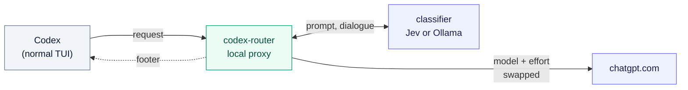

# codex-router

[](https://github.com/alexei-led/codex-router/actions/workflows/ci.yml)
[](https://github.com/alexei-led/codex-router/releases)
[](https://goreportcard.com/report/github.com/alexei-led/codex-router)
[](https://pkg.go.dev/github.com/alexei-led/codex-router)
[](go.mod)
[](LICENSE)

**The right model for every turn of a Codex session.** codex-router picks the model and reasoning effort for each turn of the [Codex CLI](https://github.com/openai/codex). Reading code and small edits go to a light model, and a fix that keeps failing goes to the strongest one. The choice shows in Codex's own footer.


<sub>Left: Codex. The same test failed twice with an edit in between, so the router moved the turn from `gpt-6-sol · medium` to `gpt-6.1-sol · high`, and the footer follows. Right: the optional panel shows why. Sample data.</sub>

## Why

Codex runs a whole session on the model you picked. With the strongest model, every directory listing and one-line rename spends your plan's usage, so it runs out sooner. With a light model, the hard bug stalls. Switching with `/model` by hand means watching every turn.

codex-router does the switching for you:

- **Per turn, automatically.** A small classifier reads your prompt and recent dialogue and rates how hard the turn is. A policy switches only when the evidence repeats, and asks for more when a switch would lose the prompt cache.
- **Visible where you work.** The Codex footer shows the routed model in any terminal. An optional panel shows why, lets you pin a model or pause, and estimates what routing saved.
- **You stay in charge.** A `/model` pick holds your model. On any router error the request goes out unchanged. If the router cannot start, you get plain `codex`.
- **Your setup is left alone.** The router never edits `~/.codex/config.toml`. Your ChatGPT login goes only to `chatgpt.com`. It is never logged and never sent to the classifier.

It is for people who use the Codex CLI with a ChatGPT sign-in and run long sessions that mix easy and hard work.

## How it works



`codex-router` starts a private Codex app-server and runs the normal Codex TUI against it. Codex sends its model requests to a proxy on `127.0.0.1`. On each turn, the proxy asks the classifier, then changes only `model` and `reasoning.effort` and forwards everything else byte for byte. It also writes the choice back into the thread settings, so the footer repaints. Compaction, subagents and anything it cannot parse pass through untouched. See [architecture](docs/architecture.md) for the details.

## Quick start

You need the Codex CLI on `PATH`, signed in with ChatGPT, on macOS or Linux.

```sh
# macOS on Apple silicon; other builds and `go install` are in the user guide
curl -fsSL -o codex-router \
  https://github.com/alexei-led/codex-router/releases/latest/download/codex-router-darwin-arm64
sudo install -m 0755 codex-router /usr/local/bin/codex-router

export TYPESAFE_API_KEY=...   # key for the default classifier (Jev); or use a local Ollama model
cd your-repo
codex-router                  # use it like `codex`; arguments pass through
```

In a second pane, run `codex-router tui` for the panel. The [user guide](docs/user-guide.md) has the other install options, configuration and troubleshooting.

## Status

Early. It was tested live against Codex 0.162.1 on macOS ([live test report](docs/archive/evidence/2026-10-14/live-test-report.md)). The footer sync uses Codex's experimental `--remote` mode and `thread/settings/update`, so a Codex update can break it. Routing keeps working when sync fails.

## Docs

- [User guide](docs/user-guide.md): install, configure, use the footer and panel, troubleshoot
- [Configuration reference](docs/configuration.md): every field, presets, classifiers
- [Architecture](docs/architecture.md): components, request flow, routing decisions, security

## License

[MIT](LICENSE)
