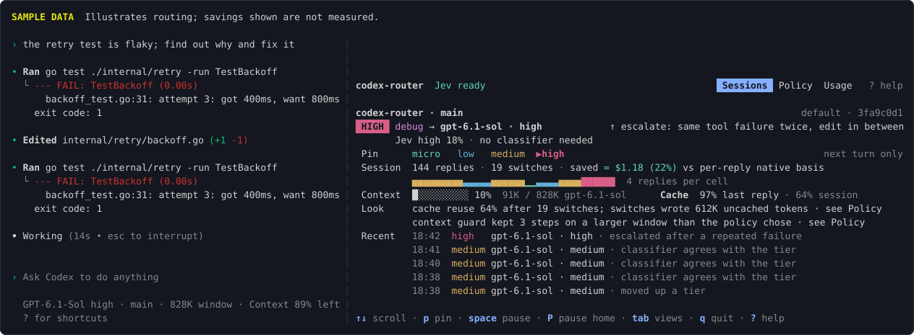
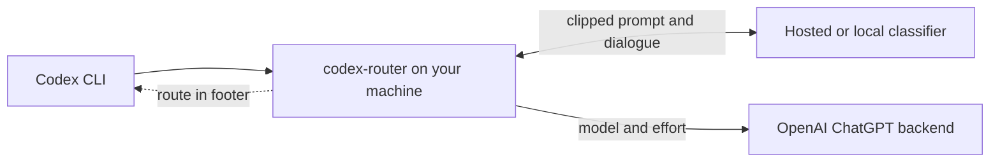

# codex-router

[](https://github.com/alexei-led/codex-router/actions/workflows/ci.yml)
[](https://github.com/alexei-led/codex-router/releases)
[](https://pkg.go.dev/github.com/alexei-led/codex-router)
[](go.mod)
[](LICENSE)

**Automatic model and reasoning effort selection for Codex CLI.**

A Codex session can start with a small edit and end with a stubborn bug. Keeping the strongest model on for everything uses more of your plan. Switching by hand means watching the model picker while you work.

codex-router picks a route for each turn. It uses lighter models for simple work and moves up when the work needs it. Codex's own footer shows the choice.



The panel is optional. This illustration uses sample data, including its savings figures.

## What you get

- **Less model picking.** A classifier scores the prompt and recent dialogue. The router uses that score, cache state and tool results to decide whether to switch.
- **A reason for each choice.** The panel shows the route and why it changed. One panel covers multiple sessions and Codex homes.
- **Cost or quality, your call.** A [routing mode](docs/user-guide.md#choose-a-routing-mode), `cost`, `balanced` or `quality`, chooses cheaper or stronger model/effort pairs. The default ladder uses Luna, Terra and Sol. Set it per profile, per repository or per session.
- **Manual control.** Use `/model` to keep your own choice. Pin the next turn or pause routing from the panel.
- **A way back.** Routing errors forward the request unchanged. Launcher startup errors fall back to plain Codex. The wrapper does not edit your Codex config.

## How it works

A classifier is a small model that rates the work. It does not answer your coding request. Hosted options include Jev, from [Typesafe](https://typesafe.ai), and Cloudflare's Clef. [Ollama](https://ollama.com) runs the classifier locally.



The router starts a private Codex app-server and a local proxy. It changes the model and effort in supported requests. Compaction, subagents and requests it cannot parse pass through unchanged. [Architecture details](docs/architecture.md).

## Try it

You need macOS or Linux, Codex CLI on `PATH`, and a ChatGPT sign-in. API-key sign-in is not supported.

**Recommended:** install the latest stable release with Homebrew (macOS or Linux):

```sh
brew install alexei-led/tap/codex-router
```

See [Install](docs/user-guide.md#install) for Homebrew trust setup and [Update or uninstall](docs/user-guide.md#update-or-uninstall) for upgrades. The formula follows stable releases; no version pin is needed.

Or download the latest binary directly on an Apple silicon Mac:

```sh
curl -fsSL -o codex-router \
  https://github.com/alexei-led/codex-router/releases/latest/download/codex-router-darwin-arm64
sudo install -m 0755 codex-router /usr/local/bin/codex-router
codex-router version
```

[Linux, Intel Mac and Go installation](docs/user-guide.md#install).

Choose where classification runs **before you start**. Your coding requests still go to OpenAI in both cases. Codex credentials are never sent to the classifier.

**Hosted classifier:** Jev is the default. Get a Typesafe API key, then run:

```sh
export TYPESAFE_API_KEY=your-key
cd your-repo
codex-router
```

Jev receives the clipped prompt and recent dialogue. If the key is missing, automatic classification is off. Pins and the context guard still work.

**Local classifier:** install and start Ollama, then run:

```sh
ollama pull qwen3.5:9b
mkdir -p ~/.config/codex-router
# Use a separate file so this example does not replace an existing config.
printf '%s\n' '{"classifier":"ollama"}' > ~/.config/codex-router/ollama.json
cd your-repo
codex-router --config ~/.config/codex-router/ollama.json
```

The default Ollama endpoint keeps classifier text on your machine. See [classifier setup and privacy](docs/user-guide.md#choose-a-classifier) for other options.

Run `codex-router tui` in a second terminal to see decisions and controls. Arguments pass through, for example `codex-router resume --last`.

## Limits

Early software. Live checks covered Codex 0.162.1 and 0.163.0 on macOS, including model and effort changes in the bottom status line. Linux service files have unit tests, but no recorded live run. Footer sync uses experimental Codex interfaces, so updates can break it.

Switching models can lose prompt-cache reuse. The policy accounts for this, but routing does not guarantee lower usage or better answers. The panel's dollar figures are list-price estimates, not ChatGPT plan billing.

The local proxy carries your ChatGPT credentials. If its process is killed, close the affected Codex session before restarting. Close a home's sessions before undoing setup. [Recovery and security limits](docs/user-guide.md#if-the-router-is-killed).

## Documentation

- [User guide](docs/user-guide.md): install, choose a classifier, use the panel, update and troubleshoot.
- [Configuration](docs/configuration.md): fields, defaults and what the classifier receives.
- [Architecture](docs/architecture.md): request flow, routing policy and security boundaries.
- [Evaluation](docs/evaluation.md): small benchmark results and their limits.
- [Contributing](CONTRIBUTING.md): build, tests and release process.

## Related projects

[pi-model-router](https://github.com/alexei-led/pi-model-router) routes models in the Pi coding agent. [claude-router](https://github.com/alexei-led/claude-router) routes Claude Code sessions and was built with Claude Mods. They started the same experiment: let the task influence the model choice. Each has its own integration and limits.

[MIT license](LICENSE).
