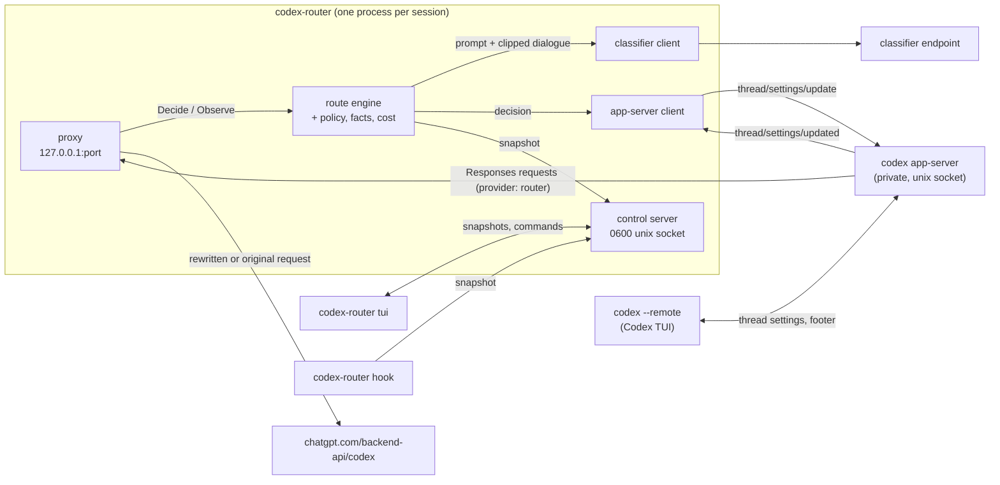

# Architecture

One launcher process per Codex session. It runs the proxy and the routing engine in-process, starts a private Codex app-server, and runs the Codex TUI against that app-server. Measured behaviour is in [research](research.md); this page says how the code is built.

## Components and data flow



Per user step:

1. Codex (the private app-server runs the model calls) posts `/v1/responses` to the proxy. The provider is `router`, with `requires_openai_auth`, so Codex sends its own ChatGPT auth.
2. The proxy buffers the body and parses it. It asks the engine to decide, under a deadline (classifier timeout plus 200 ms).
3. The engine passes through non-user steps. For a user step it asks the classifier on the turn's first step (not when pinned), runs the policy, checks the compatibility group and the context fit, and returns a model and effort, or nothing.
4. The proxy rewrites only `model` and `reasoning.effort`, and sends the request upstream. Every other byte is the original.
5. The SSE stream is copied through with a flush per chunk, minus the model headers. A tee reads `response.completed` for usage before Codex can send its next step.
6. The engine publishes the decision. The app-server client writes it to the thread settings so the footer shows it. The control server pushes a snapshot to the panel and the hook.

The engine also reviews the turn in the background every `reviewEveryRequests` requests and applies the answer at the next step.

## Why a private app-server

The footer shows the model from the thread's settings, not from the model a request used. A proxy alone cannot change it. In Codex 0.162.1 the TUI follows `thread/settings/updated` and repaints its footer, and any client of the app-server can send `thread/settings/update` with no owner check ([research §4.1](research.md#41-footer-status-that-works-in-any-terminal-a-private-app-server), [§9](research.md#9-phase-2-spikes-2026-10-13), spike 1a). An embedded app-server cannot be reached from outside, so the launcher starts its own:

- `codex --no-daemon app-server --listen unix://<runtime>/app.sock -c model_provider=router -c model_providers.router={...}`
- `codex --remote unix://<runtime>/app.sock`
- the router connects as a second client, sends `thread/resume` with `excludeTurns` once per thread (needed to receive that thread's notifications), and writes settings.

Only `-c` overrides are used. The user's `config.toml` and the shared Codex daemon are not touched. The app-server starts in the user's working directory, because a remote TUI's thread uses the app-server's cwd. The same notification carries a user's `/model` pick, which is how the router detects a manual pin: a value that is not one it wrote.

Costs of this design: a Codex build must support `--remote` and `thread/settings/update` (both experimental or private surfaces), and a protocol change can break the footer sync. When sync fails, routing still works; the panel shows `footer not synced`.

## Packages

All under `internal/`, entry point `cmd/codex-router`.

| Package      | Role                                                                                               |
| ------------ | -------------------------------------------------------------------------------------------------- |
| `config`     | Types, defaults, JSON load and validation. Leaf.                                                   |
| `responses`  | Request model, turn metadata, request kind, SSE usage, rewrite. Unknown fields pass through.       |
| `catalog`    | Model compatibility groups and context windows from `models_cache.json` and `/models`.             |
| `classifier` | Contract, `system-one` and `ollama` adapters, client with deadline, retry and breaker.             |
| `facts`      | Pure: request in, prompt, dialogue, tool failures, activity, size estimate out.                    |
| `cost`       | Per-thread, per-model prompt-cache ledger; prices a switch in uncached tokens.                     |
| `policy`     | Pure: votes, bars, escalation, holds, context-fit tier search.                                     |
| `route`      | The engine: state, decisions, snapshot, commands. Implements the proxy's and control's interfaces. |
| `proxy`      | Loopback Responses proxy and SSE relay.                                                            |
| `appserver`  | JSON-RPC client of the private app-server.                                                         |
| `control`    | JSON-lines control socket: server, client.                                                         |
| `tui`        | Bubble Tea panel; `Render` is pure.                                                                |
| `hook`       | The optional Codex hook.                                                                           |
| `launcher`   | Wires everything for one session; fallback to plain codex.                                         |

Dependencies point down; `config` imports nothing in the module.

```
cmd/codex-router
  └─ launcher ─┬─ proxy ───── responses, catalog
               ├─ route ───┬─ policy ── classifier
               │           ├─ facts, cost ── responses
               │           └─ classifier, catalog
               ├─ control ── route
               ├─ appserver
               └─ classifier, catalog
  tui, hook ── control, route
  all ── config
```

`route` implements `proxy.Decider`, `proxy.Observer` and `control.Handler` without importing `proxy` or `control`. The `launcher` is the only place that connects them. `tui` and `hook` talk to the engine only through the control socket.

## Security invariants

- **Loopback only.** The proxy refuses any listen address but `127.0.0.1`. It serves `POST /v1/responses`, `GET /v1/models` and `GET /healthz`; anything else is 404. Bodies over 32 MiB get 413.
- **Session token.** Any local user can reach a loopback port, and the port is in the app-server's argv, which `ps` shows to every user. So each session makes a random 128-bit token and puts it in the app-server's environment as `CODEX_ROUTER_TOKEN`, never in argv. The provider's `env_http_headers={"X-Codex-Router-Token"="CODEX_ROUTER_TOKEN"}` makes Codex send it on every request. `/v1/responses` and `/v1/models` without the matching header get 401 before the body is read, so nothing reaches the engine, the classifier or upstream. The header is stripped before forwarding, and the token is never logged. `/healthz` stays open. The `codex --remote` TUI uses the app-server socket and does not get the token. `codex-router proxy` runs without a token, and it prints a warning saying so.
- **Fixed upstream.** Requests go to `https://chatgpt.com/backend-api/codex` plus the allowed path. The destination never comes from a request, header or response.
- **Allow-list.** Two proxied paths. No generic forwarding.
- **No redirects.** The client refuses every redirect, and the proxy also rejects 3xx statuses the client would hand back. A refused redirect's URL, which comes from upstream, is dropped from logs.
- **Auth goes upstream only.** `Authorization` and `ChatGPT-Account-ID` are forwarded to the fixed upstream and nowhere else. The classifier input type has no header field, and the classifier sends only its own `keyEnv` bearer key to its own endpoint. The control socket and the app-server connection carry no headers or request text.
- **Hop-by-hop headers** are dropped both ways, and the served-model headers are stripped from responses.
- **Control socket `0600`**, in a runtime directory that must be `0700`, owned by the user and not a symlink. The socket mode is set right after bind; the private parent closes that window. A live socket or a non-socket file at the path is refused.
- **No body logging.** Logs hold ids, decisions, statuses, sizes and timings. The log file is `0600` in a `0700` dir. Request text kept in memory is the clipped dialogue for the classifier.
- **No re-send.** After a request goes upstream it is never sent again, not even on a stale keep-alive connection. Codex retries by itself.
- **No config edits.** The router never writes `~/.codex/config.toml`, the Codex home or the shared daemon. The hook's trust entry is the user's to add.

## State and keys

State lives in the engine, in memory, per process.

- **Thread**: keyed by `thread_id` from `x-codex-turn-metadata`, else the session id. At most 256 threads, least recently used dropped. A thread holds the native route Codex sent, the running tier and activity, the policy state (votes, hold), the footer value, manual mode and pending settings writes.
- **Turn**: `turn_id` marks a new turn. A new turn resets the step count, the turn's advice and any running review.
- **Request**: a fingerprint of the turn and the last input items identifies one request. Retries of a request resend the same body, so they hit the thread's last 8 fingerprints and get the same decision with no new classifier call.
- **Cache ledger**: per thread and per model (not per effort, since Codex's cache ignores effort). It prices each switch in uncached tokens.
- **Pin and pause**: engine-wide. A pin is consumed by the next turn that starts. Pause applies to every thread. Manual is per thread.

When history shrinks (compaction or a rewind), the engine drops the vote streak, the measured size and the ledger for that thread.

## Fail-open rules

Every error path ends in "forward the original request".

| Where                                                     | Rule                                                                                                                   |
| --------------------------------------------------------- | ---------------------------------------------------------------------------------------------------------------------- |
| Body does not parse                                       | Original bytes.                                                                                                        |
| Request kind is not `turn`, no `turn_id`, subagent header | Pass through, no decision, no classifier call.                                                                         |
| Model not in the catalog                                  | Pass through.                                                                                                          |
| Decider panics                                            | Recovered in the proxy and in the engine; original bytes.                                                              |
| Decider exceeds its deadline                              | Original bytes; a late answer is ignored.                                                                              |
| Rewrite fails                                             | Original bytes.                                                                                                        |
| Classifier error, timeout, pause                          | The turn is not routed. The one exception is the upward context fix, which needs no classifier.                        |
| Route outside the compatibility group, or does not fit    | The request keeps its model (or the lowest tier that fits).                                                            |
| Settings write fails                                      | Logged; routing continues. The footer may lag the route (the panel says `footer not synced` while writes are pending). |
| Control socket or panel gone                              | No effect on routing.                                                                                                  |
| Router cannot start                                       | One stderr line, then plain `codex`.                                                                                   |
| Proxy listener stops                                      | Bound again on the same port.                                                                                          |

The one case where the router cannot fail open is the launcher process dying: the proxy is in that process, and Codex's provider points at it ([research §9](research.md#9-phase-2-spikes-2026-10-13), spike 1b).

A hard kill (`kill -9`, OOM) also leaves the private `codex app-server` running, and it keeps retrying `http://127.0.0.1:<port>` with the user's ChatGPT `Authorization` bearer token and `ChatGPT-Account-ID`. The port is free by then, so any local user who binds it gets those credentials. The session token does not help, because Codex sends its auth whatever the listener answers. On macOS the launcher cannot tie the app-server's life to its own. After a hard kill, quit Codex and kill the orphaned `codex app-server` promptly.

## Further reading

- [research.md](research.md): extension points, spikes, risk register, what is unverified
- [hook-registration.md](hook-registration.md): hook trust spike
- [plans/2026-10-13-codex-router-impl.md](plans/2026-10-13-codex-router-impl.md): decisions D1 to D12 and the task breakdown
