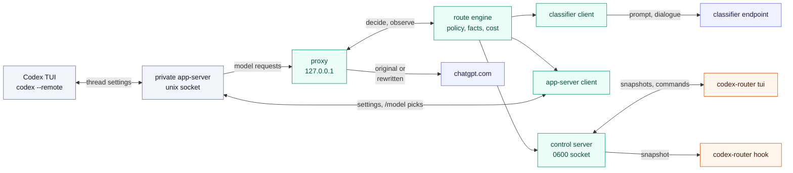
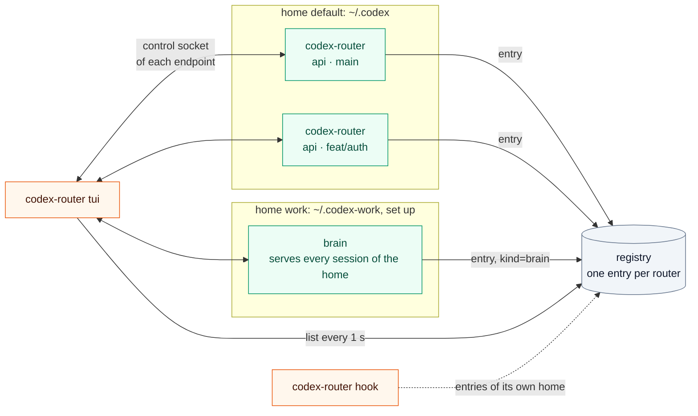
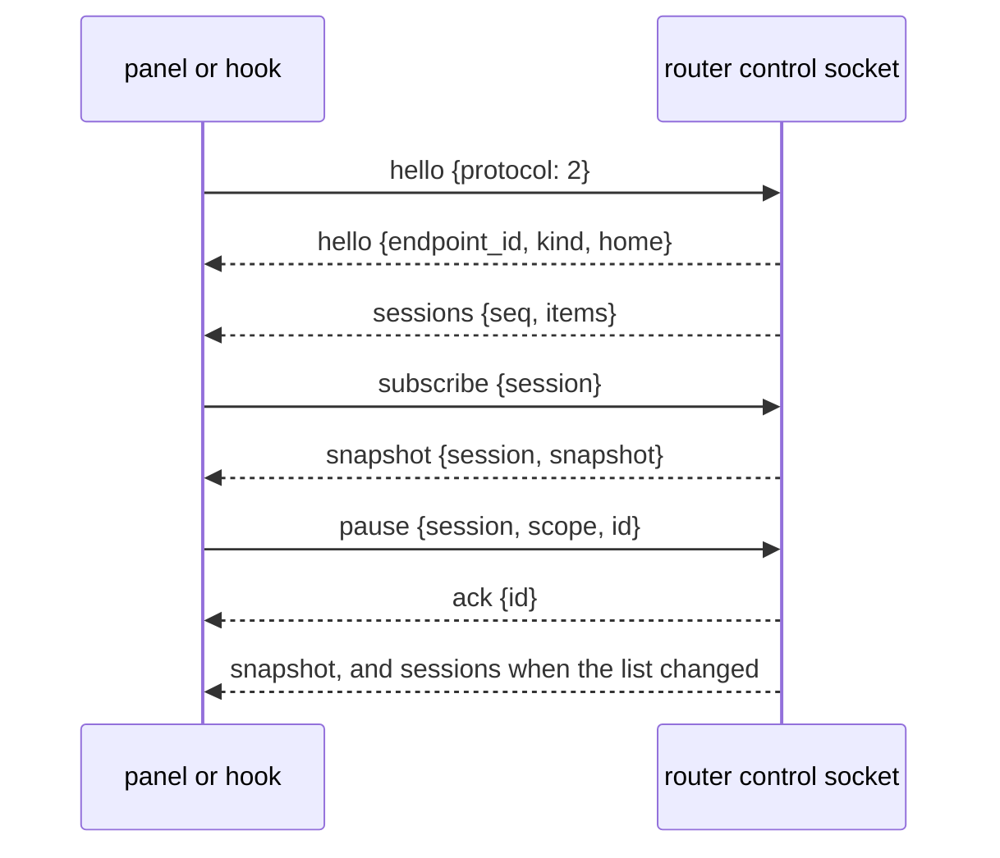
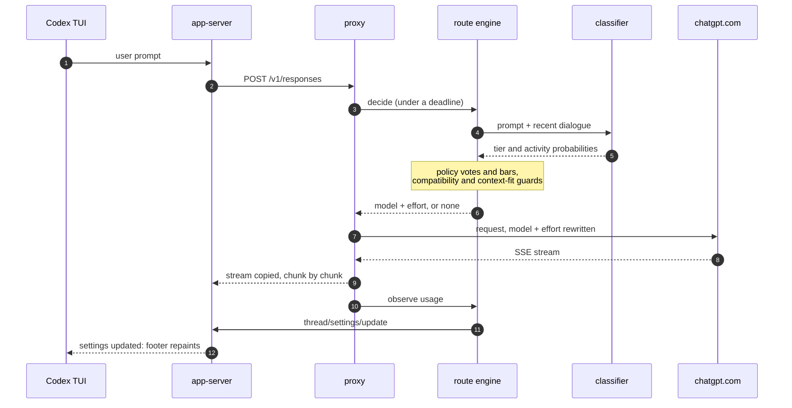
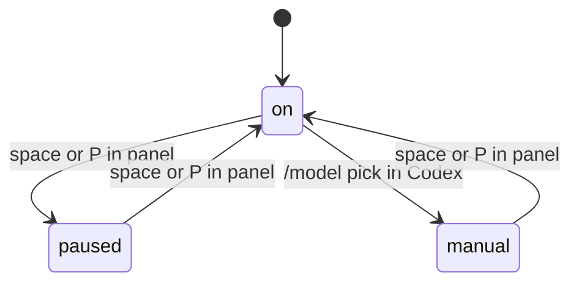
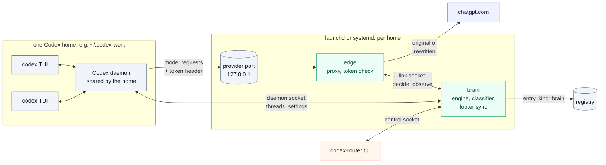
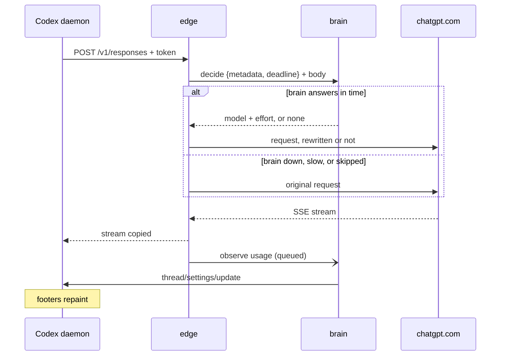

# Architecture

How codex-router is built and how one request moves through it. This page is for contributors, and for users who want to know what runs on their machine. For install and daily use, see the [user guide](user-guide.md). For every config field, see the [configuration reference](configuration.md).

Terms such as tier, activity, route, pin and compatibility group are defined in [Concepts](user-guide.md#concepts). The Codex behavior this design relies on was measured in the [research notes](archive/research.md).

## Overview

One `codex-router` process runs for each Codex session. It holds the proxy and the routing engine, starts a private Codex app-server, and runs the normal Codex TUI against that app-server. Any number of them can run at once, in any repo and under any Codex home. Each lists itself in a shared registry, so one panel shows them all (see [Sessions and the registry](#sessions-and-the-registry)).

The other mode routes a whole Codex home, so plain `codex` works: `codex-router setup` installs an edge and a brain for that home as launchd or systemd services. Both modes share the engine, the registry and the control protocol, and one panel shows both. See [A whole home: edge and brain](#a-whole-home-edge-and-brain).

Green boxes run inside the `codex-router` process. Grey boxes are Codex. Blue boxes are remote services. Orange boxes are separate `codex-router` commands that attach through the control socket.

What crosses each boundary:

- **Codex to proxy.** Model requests (`POST /v1/responses`) on `127.0.0.1`. The provider is `router` with `requires_openai_auth`, so Codex adds its own ChatGPT auth. A session token header proves the caller is the private app-server (see [Security](#security)).
- **Proxy to chatgpt.com.** The request with `model` and `reasoning.effort` possibly changed, and the SSE stream back.
- **Engine to classifier.** The clipped prompt and recent dialogue. No headers and no Codex credentials.
- **App-server client to app-server.** `thread/settings/update` writes (the footer value) and `thread/settings/updated` notifications (including `/model` picks).
- **Control socket to panel and hook.** Session lists and the subscribed session's snapshots out, and commands in (pin, pause, resume, preset), each for one session or the whole home. See [Control protocol](#control-protocol).

## Sessions and the registry

- **Home.** A Codex home is the `CODEX_HOME` directory, default `~/.codex`. Its id is the first 12 hex characters of the sha256 of its canonical path (symlinks resolved), so it is stable with no setup. Its name is display only: `.codex` is `default`, `.codex-<x>` is `<x>`, any other home is its directory name.
- **Session.** One Codex main thread. Its id is `<home id>/<thread id>`, because a thread id alone may repeat across homes. `/new` in Codex starts a new thread, so a new session. The label `home · repo · branch` comes from the `.git` of the router's working directory, read without running git. It is display only; colliding labels get four hex characters derived from the id.
- **Sessions list.** An engine lists each thread that has had a user step, most recently active first. A thread with no user step or reply for 10 minutes leaves the list, unless it is the engine's most recent thread. Every number in a list entry comes from that thread's own tallies.
- **Registry.** `$XDG_STATE_HOME/codex-router/registry`, else `~/.local/state/codex-router/registry`. One JSON file per endpoint: endpoint id, kind (`session` for a launcher, `brain` for a home's brain), protocol version, pid, start time, home (id, path, name) and control socket path. The launcher writes its entry once its control socket is up, and removes it first on every exit path, so panels stop listing it before the socket closes. A registry that cannot be written does not stop the session: it routes and prints one line that the panel will not list it.
- **Readers.** An entry is only a hint. A reader dials the socket and checks that the `hello` names the same endpoint id and home, else it ignores the endpoint. The panel removes an entry only after a failed dial, when the socket does not answer and the pid is gone. The hook never removes entries.

The panel keeps one connection per live endpoint and merges their lists. Homes are sorted by name, sessions most recently active first. It subscribes only the focused session's endpoint to that session. Home commands (`P`, `c`) go to every endpoint of the focused home, and each endpoint applies them to its own threads. When an endpoint's connection drops, its sessions show `disconnected` for 10 s and are then dropped. The panel redials while the entry remains.

The hook uses `CODEX_ROUTER_CONTROL` when the launcher set it. Otherwise it resolves its own home from `CODEX_HOME`, dials that home's entries in parallel, and takes the first endpoint whose `hello` matches its entry and whose first list has the hook's thread. The whole lookup fits in the hook's 200 ms budget.

## Control protocol

The control socket speaks JSON lines, protocol version 2. Panel, hook and `codex-router sessions` all use it.

- **Handshake.** The client's first line must be `hello` with a known protocol version. Anything else gets an `error` line and the connection closes.
- **Sessions.** The server pushes the list after the handshake and then whenever it changed, coalesced, with a `seq` that moves on each change.
- **Subscribe.** Each connection follows at most one session; an empty `session` means the list only. A later `subscribe` replaces the earlier one. The `snapshot` op re-sends the current snapshot.
- **Commands.** `pin`, `unpin`, `pause`, `resume` and `preset` carry the `session`, a `scope` (`session` or `home`) and a client-chosen `id`. The `ack` or `error` carries the same `id`, so a client can have several commands in flight. A session of another home is refused. The last write wins.

## One turn

A turn is one user prompt. It can send many requests, which this page calls steps. The classifier runs on the first step only.

Notes on the steps:

- **Step 3, deadline.** The proxy gives the engine the classifier timeout plus 200 ms. A late answer is ignored and the original request goes out.
- **Step 4, classifier.** Only the first step of a turn asks, and not when the turn is pinned. Later steps reuse the turn's route, except for the cases in [Routing decisions](#routing-decisions).
- **Step 7, rewrite.** The proxy buffers the body and changes only `model` and `reasoning.effort`. Every other byte is the original.
- **Step 10, usage.** On `response.completed`, a tee on the stream reads `response.completed` before Codex can send its next step.
- **Step 11, footer.** The write is asynchronous. If it fails, routing continues and the panel shows `footer not synced`.

The engine also reviews a running turn in the background every `reviewEveryRequests` requests. It applies the answer at the next step.

## Routing decisions

The engine decides per thread. A decision is a tier, optionally an activity, and the route (model and effort) they map to. The first diagram shows the order of the checks. The second shows how the policy turns a classifier answer into a tier.

### From request to route

Grey boxes leave the request as Codex sent it, or keep Codex's model. A retried request has the same fingerprint as the first try, so it gets the same decision with no new classifier call.

The list below adds what the diagram leaves out.

- **Which requests.** Only user steps are routed: turn metadata with `request_kind = "turn"`, a `turn_id`, `thread_source = "user"` (or none), and no `x-openai-subagent` header. Compaction, subagent steps and Codex's side threads (thread title, guardian review, memory) pass through, and side threads never show up as sessions.
- **Overrides.** A panel pin decides the next turn and is then used up. Pause sends every request unchanged. A `/model` pick (a settings value the router did not write) sets the manual hold for that thread until resume. When the router was not subscribed to the thread and got no notification, it sees the pick in the turn's first request or in the route `thread/resume` reports.
- **Moving up a tier on later steps.** Tool calls that show code, docs or ops work can move a turn up to a stronger activity route without a classifier answer.
- **Escalation.** The same tool failure twice, with an edit in between, moves one tier up without the classifier. It holds for `escalationHoldTurns` turns. Tool results come from plain tool calls and from code-mode JavaScript cells. For cells, the exit status counts only when the script printed it.
- **Compatibility group.** A route is used only inside the compatibility group of the model Codex sent (`comp_hash`, Responses Lite, tool mode). A mid-thread switch across groups fails.
- **Context fit.** A route is used only if the estimated thread size is at most `contextFill` of the route's window. If the chosen tier does not fit, the engine takes the lowest tier that does. If none fits, the request keeps its model. If the request's own model cannot hold the thread but the baseline route can, the request moves up to the baseline. This guard has not been tested live on a thread above about 220k tokens.

### From classifier answer to tier

Amber boxes move up, blue moves down, grey stays. The input is the classifier's probability for each tier.

- **Mass.** For a move up, mass is the probability above the running tier. For a move down, it is the probability at or below the target tier.
- **Votes.** A vote is one classifier answer. A move up needs `upgradeVotes` answers in a row above the running tier. A move down needs `downgradeVotes` answers at or below the target. Before the first measured reply there is no cache to protect, so one vote is enough.
- **Bars.** Each bar is a base plus a cost term: `base + slope × tax / (tax + pivot)`. The tax is the number of uncached tokens that the switch would write. The cost comes from a per-thread cache ledger, because Codex's prompt cache is per model. A switch to a model with a cold cache writes the whole prefix again. Fields: `upgradeBase`, `upgradeSlope`, `downgradeMass`, `downgradeSlope`, and the pivots.
- **Same task.** A prompt counts as the same task when the classifier scores it as a continuation (`continuationMass`), or when the answer comes from a review inside a turn. A move down on the same task also waits `minDwellRequests` requests and needs a passed test, build or lint since the last switch. That avoids dropping to a light model halfway through a fix.
- **Activity.** The same checks apply to a switch between two routes inside one tier. An activity route applies at `activityMass` on a new task.
- **Presets** replace some of these thresholds. The values are in the [configuration reference](configuration.md#presets).

### Modes

Modes are per session (thread). A home pause covers every thread of the engine on top of each thread's own state.

- **on.** Routing is active.
- **paused.** Every request of the thread goes out unchanged, and its footer returns to the model Codex sent. A session pause covers one thread. A home pause covers every thread of the engine, also threads that start later.
- **manual.** A `/model` pick holds that thread on your model.
- **Resume.** A session resume clears that thread's pause and manual hold. A home resume clears the home pause and every thread's manual hold, and keeps session pauses. A thread paused both ways routes again only when both are cleared.

## Why a private app-server

The footer shows the model from the thread's settings, not from the model a request used. A proxy alone cannot change it. In Codex 0.162.1 the TUI follows `thread/settings/updated` and repaints its footer. Any client of the app-server can send `thread/settings/update` with no owner check ([research §4.1](archive/research.md#41-footer-status-that-works-in-any-terminal-a-private-app-server), [§9](archive/research.md#9-phase-2-spikes-2026-10-13), spike 1a).

An embedded app-server cannot be reached from outside, so the launcher starts its own:

- `codex --no-daemon app-server --listen unix://<runtime>/app.sock -c model_provider=router -c model_providers.router={...}`
- `codex --remote unix://<runtime>/app.sock`
- The router connects as a second client. It sends `thread/resume` with `excludeTurns` once per thread (needed to receive that thread's notifications), and writes settings. It never answers the app-server's requests to clients (command and patch approvals): they go to every client of the thread and the first answer wins, so the Codex TUI must be the one that answers.

Only `-c` overrides are used. The user's `config.toml` and the shared Codex daemon are not touched. The app-server starts in the user's working directory, because a remote TUI's thread uses the app-server's cwd. The same notification carries a user's `/model` pick. That is how the router detects the manual hold: a value that is not one it wrote.

Costs of this design: a Codex build must support `--remote` and `thread/settings/update`, both experimental or private surfaces. A protocol change can break the footer sync. When sync fails, routing still works.

## A whole home: edge and brain

`codex-router setup --home H` routes every plain `codex` session of one Codex home. It splits the launcher's process in two, per home: a small **edge** that holds the provider port, and a restartable **brain** with the engine. Plain `codex` runs its threads in the home's shared Codex daemon, so the brain follows that daemon instead of starting a private app-server.

Each home gets its own edge, brain, port, token, state dir and units. Nothing is shared across homes, so accounts, daemon connections and restarts stay apart.

### One step through the edge

- **Edge.** The same proxy as the launcher's, with a link client as its decider. It checks the token, and holds no routing state. A config that does not load makes it warn and use the defaults: the port must not go dead.
- **Link.** A unix socket in the home's state dir (`brain.sock`, `0600`). A frame is a 4-byte length, a JSON header line and the raw body, so bodies never leave the machine. The `hello` names the home id, and a brain refuses another home. The edge gives a decide its remaining deadline (classifier timeout plus 200 ms). Dial and hello get 200 ms, redials back off from 50 ms to 2 s, and three decide timeouts in a row make the edge skip the brain for 10 s. Usage reports wait in a queue of 256 and are dropped when it is full. A decide goes out after the reports queued before it, so the brain counts a reply before the next step. A decide that reaches the brain past its deadline is dropped, and one whose deadline passes in the engine records nothing: no decision, footer write or spent pin. Every failure means "forward unchanged".
- **Brain.** The engine, the classifier and the footer writer of the launcher, plus a client of the home's daemon (`$CODEX_HOME/app-server-control/app-server-control.sock`). At start it lists the loaded threads, and later it picks up `thread/started`. It resumes each main thread with `excludeTurns` to get its notifications and cwd, and skips subagent and side threads. A thread with no turn and no settings event for 10 minutes is unsubscribed, so the daemon can unload it. A lost daemon is redialed (250 ms, doubling to 8 s), and every thread is resubscribed and its footer resynced. Like the launcher, the brain never answers the daemon's approval requests. It serves control protocol v2 as a `brain` endpoint with the fixed id `brain-<home id>`, so a restarted brain replaces its own registry entry.
- **Brain restart.** Learned state (tier, votes, escalation, cache ledger) is gone after a restart. With an empty ledger the engine would take the cache for cold and switch on one vote, so each resumed thread is seeded with the route `thread/resume` reports and held there, attention `unknown`, until its first reply measures the cache. Steps of a turn that started held keep that route. Then routing goes on as usual. User intent (home pause, session pauses, manual holds, pending pins, a preset picked by command) is written to `intent.json` atomically on every change, not at exit, because a crash skips exit handlers. The brain reads it at start.
- **Account binding.** The proxy hashes `ChatGPT-Account-ID` (sha256, first 12 hex) into the request metadata. A thread binds to its first account. A different account resets that thread's learned state and keeps its intent. A missing account changes nothing. This covers a new login inside one home, in both modes.

### Units and setup

| Unit  | macOS (launchd agent)                                                                                                                                                     | Linux (systemd user unit)                                                                                                                             |
| ----- | ------------------------------------------------------------------------------------------------------------------------------------------------------------------------- | ----------------------------------------------------------------------------------------------------------------------------------------------------- |
| edge  | `com.github.alexei-led.codex-router.<home id>.edge`. `Sockets` holds the port; the job starts on the first connection and takes the socket with `launch_activate_socket`. | `codex-router-edge@<home id>.socket` holds the port; it starts `codex-router-edge@<home id>.service` (`Restart=on-failure`), which gets `LISTEN_FDS`. |
| brain | `com.github.alexei-led.codex-router.<home id>.brain`, `RunAtLoad` and `KeepAlive`.                                                                                        | `codex-router-brain@<home id>.service`, `Restart=always`.                                                                                             |
| logs  | `<home state dir>/logs/{edge,brain}.log`                                                                                                                                  | the journal                                                                                                                                           |

- **Socket activation.** The service manager owns the listening socket. A crashed or upgraded edge never frees the port, so the next connection waits in the backlog for the new edge and no other process can take the port. On macOS, `launch_activate_socket` is called through `purego`, so builds stay `CGO_ENABLED=0`. An edge started without activation (by hand) binds the stored port itself and warns.
- **Flags.** launchd and systemd do not see the shell's env, so every unit gets `--home`, `--state-dir` and `--config` as absolute paths. The brain reads the classifier key from the env, else from the classifier's `envFile`.
- **State dir.** `<state>/codex-router/homes/<home id>/`: `port`, `token`, `intent.json`, the link and control sockets, and launchd's logs. A socket path over the unix limit (104 bytes on macOS, 108 on Linux) moves to `$TMPDIR/codex-router-<uid>/`, and the brain records it in the state dir (`brain.path`) and the edge reads that before each dial. The dir and its parents up to `codex-router/` must be private, or the edge and brain refuse to start.
- **Setup.** It prints the home, then the diff. It stores the port and token, installs and loads the units, and only then writes `config.toml`, so Codex never points at a port that nothing holds. The edit is two marked blocks, `# >>> codex-router >>>` to `# <<< codex-router <<<`: `model_provider = "router"` before the first table, and the provider table at the end. The result is checked with a TOML parser: it must decode to the old settings plus the router. `--undo` restores `config.toml` first, then removes the units.
- **Plugin.** It ships hooks and a skill, no binary. The SessionStart hook runs `codex-router service ensure` detached, so it never delays a session. UserPromptSubmit and Stop run `codex-router hook`. The `router` skill runs `codex-router ctl`. Codex runs plugin hooks with the env of the shell that started the daemon, so all of them go through a wrapper that reads the binary and state dir from `<home>/codex-router.env`, which setup writes.

## Packages

All packages are under `internal/`. The entry point is `cmd/codex-router`. Dependencies point down: `config` imports nothing in the module, and every package may import it.

| Package      | Role                                                                                           | Imports                                                                                        |
| ------------ | ---------------------------------------------------------------------------------------------- | ---------------------------------------------------------------------------------------------- |
| `config`     | Types, defaults, JSON load and validation.                                                     | none                                                                                           |
| `home`       | Codex home id and name from `CODEX_HOME`. Session labels from `.git`.                          | none                                                                                           |
| `registry`   | Endpoint entries: root dir checks, atomic write, list, prune.                                  | `home`                                                                                         |
| `responses`  | Request model, turn metadata, request kind, SSE usage, rewrite. Unknown fields pass through.   | `config`                                                                                       |
| `catalog`    | Model compatibility groups and context windows from `models_cache.json` and `/models`.         | `config`                                                                                       |
| `classifier` | Contract, `system-one` and `ollama` adapters, client with deadline, retry and breaker.         | `config`                                                                                       |
| `facts`      | Pure: request in, prompt, dialogue, tool failures, activity, size estimate out.                | `responses`                                                                                    |
| `cost`       | Per-thread, per-model prompt-cache ledger. Prices a switch in uncached tokens.                 | `config`, `responses`                                                                          |
| `policy`     | Pure: votes, bars, escalation, holds, context-fit tier search.                                 | `classifier`, `config`                                                                         |
| `route`      | The engine: per-thread state, decisions, snapshots, sessions list, commands.                   | `catalog`, `classifier`, `config`, `cost`, `facts`, `home`, `policy`, `responses`              |
| `proxy`      | Loopback Responses proxy and SSE relay.                                                        | `catalog`, `responses`                                                                         |
| `appserver`  | JSON-RPC client of the private app-server, and of a home's shared daemon for the brain.        | `config`                                                                                       |
| `control`    | JSON-lines control socket, protocol v2: server and client.                                     | `home`, `route`                                                                                |
| `tui`        | Bubble Tea panel over every registry endpoint. `Render` is pure.                               | `config`, `control`, `home`, `registry`, `route`                                               |
| `hook`       | The optional Codex hook.                                                                       | `control`, `home`, `registry`, `route`                                                         |
| `launcher`   | Wires everything for one session. Falls back to plain `codex`.                                 | the runtime packages                                                                           |
| `link`       | Edge-brain socket: frames, a fail-open client (decider, observer) and a server over an engine. | `proxy`, `registry`, `responses`                                                               |
| `listen`     | The edge's listening socket from systemd (`LISTEN_FDS`) or launchd (`launch_activate_socket`). | none                                                                                           |
| `brain`      | A home's router: engine, daemon client, footer sync, link and control servers, saved intent.   | `appserver`, `config`, `control`, `home`, `launcher`, `link`, `registry`, `responses`, `route` |
| `service`    | launchd and systemd units of a home: render, install, load, status, ensure.                    | `proxy`                                                                                        |
| `setup`      | `codex-router setup`: `config.toml` blocks, port and token, units, undo.                       | `brain`, `home`, `launcher`, `proxy`, `registry`, `service`                                    |

`route` implements `proxy.Decider`, `proxy.Observer` and `control.Handler` without importing `proxy` or `control`. The `launcher` connects them for one session, and the `brain` for a home: each writes its registry entry. The edge in `cmd/codex-router` connects a `proxy` to a `link` client. `tui` and `hook` import `route` for its snapshot, sessions list and command types. At run time they find engines through the registry and reach them only through the control socket.

## State

State lives in the engine, in memory, per process. A brain also saves the user's intent to disk (see [A whole home](#a-whole-home-edge-and-brain)).

- **Thread.** Keyed by `thread_id` from `x-codex-turn-metadata`, else the session id. At most 256 threads, least recently used dropped; a thread with intent (pause, pin or manual hold) is never dropped, so the count can pass 256 by those. A thread holds the native route Codex sent, the running tier and activity, the policy state (votes, hold), the footer value, the manual hold and pending settings writes.
- **Turn.** A new `turn_id` starts a new turn. It resets the step count, the turn's advice and any running review.
- **Request.** A fingerprint of the turn and the last input items identifies one request. A retry resends the same body, so it hits one of the thread's last 8 fingerprints.
- **Cache ledger.** Per thread and per model, not per effort, because Codex's cache ignores effort.
- **Tallies.** Replies, switches, the reply strip, the last switch and the recent decisions are per thread, so a busy thread never pushes another thread's turns out. Home totals in the panel are sums over the home's sessions.
- **Pin and pause.** Per thread. A pin is used up by that thread's next turn, and never by another thread. A pin or pause sent before a thread's first step holds for it. The home pause and the preset are engine-wide. A home can have several endpoints (launchers, and a brain), so the panel sends them to every endpoint of the home. The manual hold is per thread.

When history shrinks (compaction or a rewind), the engine drops the vote streak, the measured size and the ledger for that thread.

## Failure handling

Every error path ends in "forward the original request".

| Where                                                     | Behavior                                                                                                                                                       |
| --------------------------------------------------------- | -------------------------------------------------------------------------------------------------------------------------------------------------------------- |
| Body does not parse                                       | Original bytes.                                                                                                                                                |
| Request kind is not `turn`, no `turn_id`, subagent header | Pass through, no decision, no classifier call.                                                                                                                 |
| Model not in the catalog                                  | Pass through.                                                                                                                                                  |
| Decider panics                                            | Recovered in the proxy and in the engine. Original bytes.                                                                                                      |
| Decider exceeds its deadline                              | Original bytes. A late answer is ignored.                                                                                                                      |
| Rewrite fails                                             | Original bytes.                                                                                                                                                |
| Classifier error, timeout, pause                          | The turn is not routed. The one exception is the upward context fix, which needs no classifier.                                                                |
| Route outside the compatibility group, or does not fit    | The request keeps its model, or takes the lowest tier that fits.                                                                                               |
| Upstream error before any output                          | Codex gets a 502 and retries on its own. The router never re-sends a request.                                                                                  |
| Stream cut after output started                           | Codex keeps the partial output. Nothing is re-sent.                                                                                                            |
| Settings write fails                                      | Logged. Routing continues. The footer may lag the route (the panel says `footer not synced` while writes are pending).                                         |
| Control socket or panel gone                              | No effect on routing.                                                                                                                                          |
| Router cannot start                                       | One stderr line, then plain `codex`.                                                                                                                           |
| Proxy listener stops                                      | Bound again on the same port.                                                                                                                                  |
| Brain down, slow or restarting (edge)                     | Original bytes. After three decide timeouts in a row, the edge skips the brain for 10 s.                                                                       |
| Edge crash or upgrade                                     | The service manager keeps the port. The next connection waits for the new edge: 18-35 ms in the gate, about 0.1 s in the live run. Codex retries a cut stream. |
| Edge unit not loaded                                      | Nothing holds the port. Codex retries until it listens again (`codex-router service ensure`).                                                                  |
| Config does not load                                      | The edge forwards with the defaults. The brain exits, and the edge forwards unchanged until it is back.                                                        |
| Home's daemon restarts                                    | The brain redials, resubscribes every thread and resyncs footers.                                                                                              |
| Brain restarts                                            | Each thread is held on the route Codex reports until its next reply. Intent is reloaded.                                                                       |
| `intent.json` unreadable                                  | The home starts paused, and its sessions show `state lost` until a home resume. Nothing is saved meanwhile, so a restart still shows it. A missing file is a first start.                                               |
| Brain without a model catalog                             | `models_cache.json` is read at brain start. A brain started before the home's first Codex run knows no model, so requests pass through until it restarts.      |
| Another ChatGPT account on a thread                       | That thread's learned state is reset. Pauses, holds and pins stay.                                                                                             |

The one case where the router cannot fail open is the launcher process dying. The proxy is in that process, and Codex's provider points at it ([research §9](archive/research.md#9-phase-2-spikes-2026-10-13), spike 1b). A hard kill (`kill -9`, out-of-memory kill) also leaves the private `codex app-server` running. See [Security](#security) for the exposure, and [If the router is killed](user-guide.md#if-the-router-is-killed) for what to do. A set-up home avoids it: the service manager holds the port while the edge is down, so the case shrinks to an edge unit that is not loaded.

## Security

- **Loopback only.** The proxy refuses any listen address but `127.0.0.1`. It serves `POST /v1/responses`, `GET /v1/models` and `GET /healthz`. Anything else is 404. Bodies over 32 MiB get 413.
- **Session token.** Any local user can reach a loopback port, and the port is in the app-server's argv, which `ps` shows to every user. So each session makes a random 128-bit token and puts it in the app-server's environment as `CODEX_ROUTER_TOKEN`, never in argv. The provider's `env_http_headers={"X-Codex-Router-Token"="CODEX_ROUTER_TOKEN"}` makes Codex send it on every request. A `/v1/responses` or `/v1/models` request without the matching header gets 401 before the body is read, so nothing reaches the engine, the classifier or upstream. The header is stripped before forwarding, and the token is never logged. `/healthz` stays open. The `codex --remote` TUI uses the app-server socket and does not get the token. `codex-router proxy` runs without a token and prints a warning.
- **Home token (setup).** The shared daemon does not inherit the router's env, so `env_http_headers` cannot work there. Setup makes a random 128-bit token per home and writes it as a static `http_headers = { "X-Codex-Router-Token" = "…" }` in the router provider block of `config.toml`. It sets `config.toml` to `0600` and refuses a symlinked one (usually a dotfiles repo, where the token would get committed) unless `--follow-symlink`. The edge reads the same token from `token` (`0600`) in the home's private state dir. The diff that setup prints redacts it, and nothing prints or logs it.
- **Socket activation.** The service manager owns the edge's port. While the edge unit is loaded, the port is never free, also during an edge crash or upgrade, so no other process can bind it and receive Codex's credentials.
- **Link socket `0600`.** The edge-brain socket and the brain's control socket sit in the home's state dir, which must be private along with its parents up to `codex-router/`. The `hello` names the home id, and a brain refuses another home. Frames carry request metadata and bodies on the local machine only, never raw auth headers.
- **Account hash.** The proxy keeps only `sha256(ChatGPT-Account-ID)`, first 12 hex, in the request metadata, to bind a thread to its account. The raw value goes upstream only, never to the engine, the link, logs or state files.
- **Services run as the user.** launchd agents and systemd user units, no root. Setup never copies the classifier key into a unit or any file of its own; the brain reads it from `envFile`.
- **Fixed upstream.** Requests go to `https://chatgpt.com/backend-api/codex` plus an allowed path. The destination never comes from a request, header or response.
- **Allow-list.** Two proxied paths. No generic forwarding.
- **No redirects.** The client refuses every redirect, and the proxy also rejects 3xx statuses that the client would hand back. A refused redirect's URL, which comes from upstream, is dropped from logs.
- **Auth goes upstream only.** `Authorization` and `ChatGPT-Account-ID` are forwarded to the fixed upstream and nowhere else. The classifier input type has no header field. The classifier sends only its own `keyEnv` bearer key to its own endpoint. That key comes from the env, else from the classifier's `envFile` (refused unless `0600`), and is never logged. The control socket and the app-server connection carry no headers or request text.
- **Hop-by-hop headers** are dropped both ways, and the served-model headers are stripped from responses.
- **Control socket `0600`**, in a runtime directory that must be `0700`, owned by the user and not a symlink. The socket mode is set right after bind, and the private parent closes that window. A live socket or a non-socket file at the path is refused.
- **Registry `0700`, entries `0600`.** Whoever can write the registry can point panels and hooks at their own socket. So the `codex-router` state dir and the registry dir must be real directories, owned by the user, with no group or other access, or the reader refuses them. Entries are written to a temp file and renamed. They hold ids, a pid, the home path and the socket path, no secrets. A reader trusts an endpoint only when its `hello` matches the entry.
- **No body logging.** Logs hold ids, decisions, statuses, sizes and timings. The log file is `0600` in a `0700` directory. Request text kept in memory is the clipped dialogue for the classifier.
- **No re-send.** After a request goes upstream it is never sent again, not even on a stale keep-alive connection. Codex retries by itself.
- **Config edits only by setup.** The launcher never writes `~/.codex/config.toml` or the Codex home, and never touches the shared daemon. `codex-router setup` edits `config.toml` only inside its marked blocks, checks the result with a TOML parser, and writes a timestamped `0600` backup first. It writes `codex-router.env` next to it. It never writes hook trust: Codex asks the user. The brain connects to the home's daemon as a client and never stops or restarts it.

### Known exposure: a hard-killed router

After `kill -9` or an out-of-memory kill, the private `codex app-server` keeps retrying `http://127.0.0.1:<port>` with the user's ChatGPT `Authorization` bearer token and `ChatGPT-Account-ID`. The port is free by then, so any local user who binds it gets those credentials. The session token does not help, because Codex sends its auth whatever the listener answers. On macOS the launcher cannot tie the app-server's life to its own.

A set-up home closes this for edge crashes and upgrades, because the service manager keeps the port (see [Socket activation](#security)). It remains when the edge unit is not loaded, for example after `launchctl bootout`, or after `setup --undo` while a thread that started with the router is still running.

## Further reading

- [research notes](archive/research.md): Codex extension points, spikes, risk register, what is unverified
- [implementation plan](archive/plans/2026-10-13-codex-router-impl.md): decisions D1 to D12
- [live test report](archive/evidence/2026-10-14/live-test-report.md): what was checked against a real Codex, and the bugs it found
- [multi-session plan](archive/plans/20261014-multi-session-router.md): decisions M1 to M13 for sessions, the registry, the edge and the brain
- [stage 1 live run](archive/evidence/2026-10-14-multi-session/stage1/report.md): five `codex-router` sessions in two homes, the checks and the bug found ([captures](archive/evidence/2026-10-14-multi-session/stage1/))
- [stage 2 gate](archive/evidence/2026-10-14-multi-session/gate/report.md): G1 to G5 on a test home, the Codex facts the edge and brain rely on ([captures](archive/evidence/2026-10-14-multi-session/gate/))
- [stage 2 live run](archive/evidence/2026-10-14-multi-session/stage2/report.md): five plain `codex` sessions in two set-up homes, edge and brain kills, daemon restart, undo, and the bugs found ([captures](archive/evidence/2026-10-14-multi-session/stage2/))
