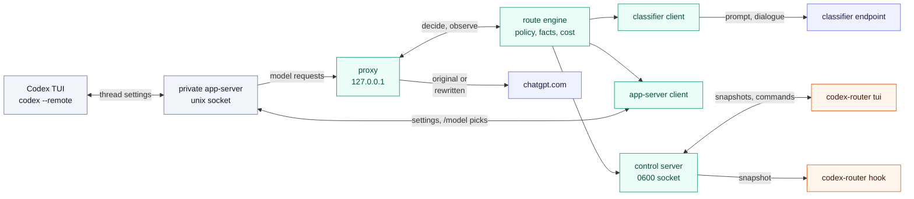
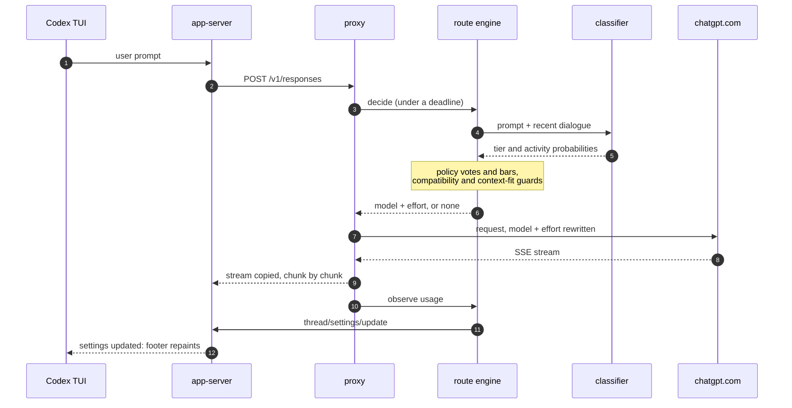
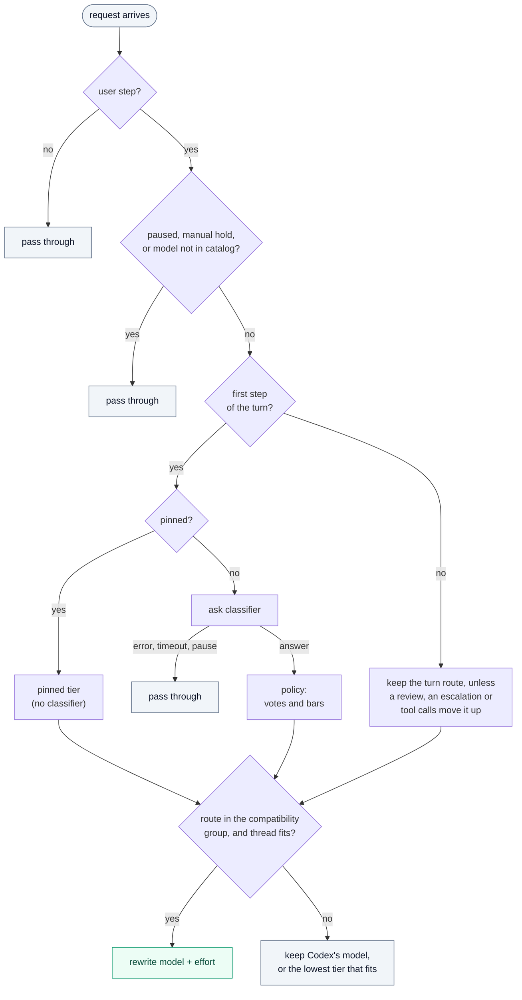
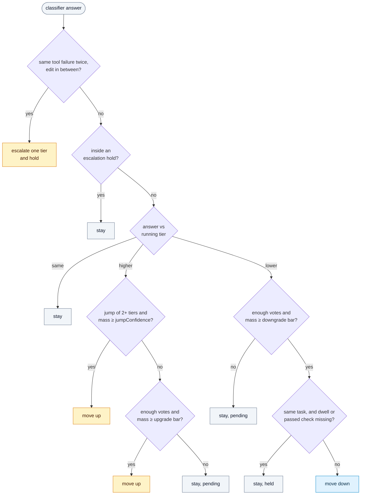
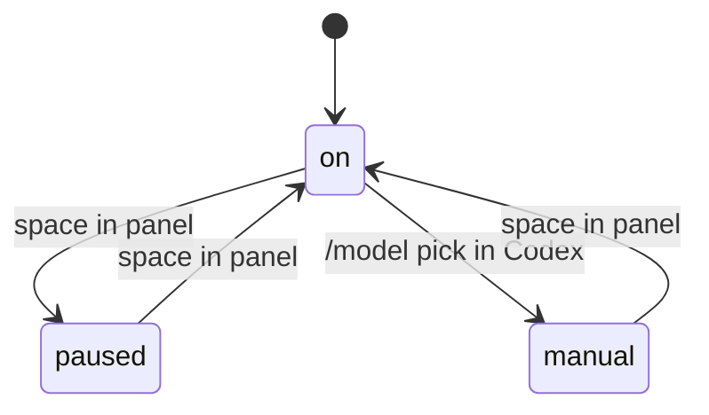

# Architecture

How codex-router is built and how one request moves through it. This page is for contributors, and for users who want to know what runs on their machine. For install and daily use, see the [user guide](user-guide.md). For every config field, see the [configuration reference](configuration.md).

Terms such as tier, activity, route, pin and compatibility group are defined in [Concepts](user-guide.md#concepts). The Codex behavior this design relies on was measured in the [research notes](archive/research.md).

## Overview

One `codex-router` process runs for each Codex session. It holds the proxy and the routing engine, starts a private Codex app-server, and runs the normal Codex TUI against that app-server.

Green boxes run inside the `codex-router` process. Grey boxes are Codex. Blue boxes are remote services. Orange boxes are separate `codex-router` commands that attach through the control socket.

What crosses each boundary:

- **Codex to proxy.** Model requests (`POST /v1/responses`) on `127.0.0.1`. The provider is `router` with `requires_openai_auth`, so Codex adds its own ChatGPT auth. A session token header proves the caller is the private app-server (see [Security](#security)).
- **Proxy to chatgpt.com.** The request with `model` and `reasoning.effort` possibly changed, and the SSE stream back.
- **Engine to classifier.** The clipped prompt and recent dialogue. No headers and no Codex credentials.
- **App-server client to app-server.** `thread/settings/update` writes (the footer value) and `thread/settings/updated` notifications (including `/model` picks).
- **Control socket to panel and hook.** Snapshots out, and commands in (pin, pause, resume, preset).

## One turn

A turn is one user prompt. It can send many requests, which this page calls steps. The classifier runs on the first step only.

Notes on the steps:

- **Step 3, deadline.** The proxy gives the engine the classifier timeout plus 200 ms. A late answer is ignored and the original request goes out.
- **Step 4, classifier.** Only the first step of a turn asks, and not when the turn is pinned. Later steps reuse the turn's route, except for the cases in [Routing decisions](#routing-decisions).
- **Step 7, rewrite.** The proxy buffers the body and changes only `model` and `reasoning.effort`. Every other byte is the original.
- **Step 10, usage.** On `response.completed`, a tee on the stream reads `response.completed` before Codex can send its next step.
- **Step 11, footer.** The write is asynchronous. If it fails, routing continues and the panel shows `footer not synced`.

The engine also reviews a running turn in the background every `reviewEveryRequests` requests. It applies the answer at the next step.

## Routing decisions

The engine decides per thread. A decision is a tier, optionally an activity, and the route (model and effort) they map to. The first diagram shows the order of the checks. The second shows how the policy turns a classifier answer into a tier.

### From request to route

Grey boxes leave the request as Codex sent it, or keep Codex's model. A retried request has the same fingerprint as the first try, so it gets the same decision with no new classifier call.

The list below adds what the diagram leaves out.

- **Which requests.** Only user steps are routed: turn metadata with `request_kind = "turn"`, a `turn_id`, and no `x-openai-subagent` header. Compaction and subagent steps pass through.
- **Overrides.** A panel pin decides the next turn and is then used up. Pause sends every request unchanged. A `/model` pick (a settings value the router did not write) sets the manual hold for that thread until resume.
- **Moving up a tier on later steps.** Tool calls that show code, docs or ops work can move a turn up to a stronger activity route without a classifier answer.
- **Escalation.** The same tool failure twice, with an edit in between, moves one tier up without the classifier. It holds for `escalationHoldTurns` turns. Tool results come from plain tool calls and from code-mode JavaScript cells. For cells, the exit status counts only when the script printed it.
- **Compatibility group.** A route is used only inside the compatibility group of the model Codex sent (`comp_hash`, Responses Lite, tool mode). A mid-thread switch across groups fails.
- **Context fit.** A route is used only if the estimated thread size is at most `contextFill` of the route's window. If the chosen tier does not fit, the engine takes the lowest tier that does. If none fits, the request keeps its model. If the request's own model cannot hold the thread but the baseline route can, the request moves up to the baseline. This guard has not been tested live on a thread above about 220k tokens.

### From classifier answer to tier

Amber boxes move up, blue moves down, grey stays. The input is the classifier's probability for each tier.

- **Mass.** For a move up, mass is the probability above the running tier. For a move down, it is the probability at or below the target tier.
- **Votes.** A vote is one classifier answer. A move up needs `upgradeVotes` answers in a row above the running tier. A move down needs `downgradeVotes` answers at or below the target. Before the first measured reply there is no cache to protect, so one vote is enough.
- **Bars.** Each bar is a base plus a cost term: `base + slope × tax / (tax + pivot)`. The tax is the number of uncached tokens that the switch would write. The cost comes from a per-thread cache ledger, because Codex's prompt cache is per model. A switch to a model with a cold cache writes the whole prefix again. Fields: `upgradeBase`, `upgradeSlope`, `downgradeMass`, `downgradeSlope`, and the pivots.
- **Same task.** A prompt counts as the same task when the classifier scores it as a continuation (`continuationMass`), or when the answer comes from a review inside a turn. A move down on the same task also waits `minDwellRequests` requests and needs a passed test, build or lint since the last switch. That avoids dropping to a light model halfway through a fix.
- **Activity.** The same checks apply to a switch between two routes inside one tier. An activity route applies at `activityMass` on a new task.
- **Presets** replace some of these thresholds. The values are in the [configuration reference](configuration.md#presets).

### Modes

- **on.** Routing is active.
- **paused.** Every request goes out unchanged. The footer returns to the model Codex sent. Pause applies to every thread.
- **manual.** A `/model` pick holds that thread on your model. Manual is per thread. Resume clears the hold on all threads.

## Why a private app-server

The footer shows the model from the thread's settings, not from the model a request used. A proxy alone cannot change it. In Codex 0.162.1 the TUI follows `thread/settings/updated` and repaints its footer. Any client of the app-server can send `thread/settings/update` with no owner check ([research §4.1](archive/research.md#41-footer-status-that-works-in-any-terminal-a-private-app-server), [§9](archive/research.md#9-phase-2-spikes-2026-10-13), spike 1a).

An embedded app-server cannot be reached from outside, so the launcher starts its own:

- `codex --no-daemon app-server --listen unix://<runtime>/app.sock -c model_provider=router -c model_providers.router={...}`
- `codex --remote unix://<runtime>/app.sock`
- The router connects as a second client. It sends `thread/resume` with `excludeTurns` once per thread (needed to receive that thread's notifications), and writes settings.

Only `-c` overrides are used. The user's `config.toml` and the shared Codex daemon are not touched. The app-server starts in the user's working directory, because a remote TUI's thread uses the app-server's cwd. The same notification carries a user's `/model` pick. That is how the router detects the manual hold: a value that is not one it wrote.

Costs of this design: a Codex build must support `--remote` and `thread/settings/update`, both experimental or private surfaces. A protocol change can break the footer sync. When sync fails, routing still works.

## Packages

All packages are under `internal/`. The entry point is `cmd/codex-router`. Dependencies point down: `config` imports nothing in the module, and every package may import it.

| Package      | Role                                                                                         | Imports                                                                   |
| ------------ | -------------------------------------------------------------------------------------------- | ------------------------------------------------------------------------- |
| `config`     | Types, defaults, JSON load and validation.                                                   | none                                                                      |
| `responses`  | Request model, turn metadata, request kind, SSE usage, rewrite. Unknown fields pass through. | `config`                                                                  |
| `catalog`    | Model compatibility groups and context windows from `models_cache.json` and `/models`.       | `config`                                                                  |
| `classifier` | Contract, `system-one` and `ollama` adapters, client with deadline, retry and breaker.       | `config`                                                                  |
| `facts`      | Pure: request in, prompt, dialogue, tool failures, activity, size estimate out.              | `responses`                                                               |
| `cost`       | Per-thread, per-model prompt-cache ledger. Prices a switch in uncached tokens.               | `config`, `responses`                                                     |
| `policy`     | Pure: votes, bars, escalation, holds, context-fit tier search.                               | `classifier`, `config`                                                    |
| `route`      | The engine: state, decisions, snapshot, commands.                                            | `catalog`, `classifier`, `config`, `cost`, `facts`, `policy`, `responses` |
| `proxy`      | Loopback Responses proxy and SSE relay.                                                      | `catalog`, `responses`                                                    |
| `appserver`  | JSON-RPC client of the private app-server.                                                   | `config`                                                                  |
| `control`    | JSON-lines control socket: server and client.                                                | `route`                                                                   |
| `tui`        | Bubble Tea panel. `Render` is pure.                                                          | `catalog`, `classifier`, `config`, `control`, `policy`, `route`           |
| `hook`       | The optional Codex hook.                                                                     | `config`, `control`, `route`                                              |
| `launcher`   | Wires everything for one session. Falls back to plain `codex`.                               | the runtime packages                   |

`route` implements `proxy.Decider`, `proxy.Observer` and `control.Handler` without importing `proxy` or `control`. The `launcher` is the only place that connects them. `tui` and `hook` import `route` for its snapshot and command types. At run time they reach the engine only through the control socket.

## State

State lives in the engine, in memory, per process.

- **Thread.** Keyed by `thread_id` from `x-codex-turn-metadata`, else the session id. At most 256 threads, least recently used dropped. A thread holds the native route Codex sent, the running tier and activity, the policy state (votes, hold), the footer value, the manual hold and pending settings writes.
- **Turn.** A new `turn_id` starts a new turn. It resets the step count, the turn's advice and any running review.
- **Request.** A fingerprint of the turn and the last input items identifies one request. A retry resends the same body, so it hits one of the thread's last 8 fingerprints.
- **Cache ledger.** Per thread and per model, not per effort, because Codex's cache ignores effort.
- **Pin and pause.** Engine-wide. A pin is used up by the next turn that starts. Pause applies to every thread. The manual hold is per thread.

When history shrinks (compaction or a rewind), the engine drops the vote streak, the measured size and the ledger for that thread.

## Failure handling

Every error path ends in "forward the original request".

| Where                                                     | Behavior                                                                                                               |
| --------------------------------------------------------- | ---------------------------------------------------------------------------------------------------------------------- |
| Body does not parse                                       | Original bytes.                                                                                                        |
| Request kind is not `turn`, no `turn_id`, subagent header | Pass through, no decision, no classifier call.                                                                         |
| Model not in the catalog                                  | Pass through.                                                                                                          |
| Decider panics                                            | Recovered in the proxy and in the engine. Original bytes.                                                              |
| Decider exceeds its deadline                              | Original bytes. A late answer is ignored.                                                                              |
| Rewrite fails                                             | Original bytes.                                                                                                        |
| Classifier error, timeout, pause                          | The turn is not routed. The one exception is the upward context fix, which needs no classifier.                        |
| Route outside the compatibility group, or does not fit    | The request keeps its model, or takes the lowest tier that fits.                                                       |
| Upstream error before any output                          | Codex gets a 502 and retries on its own. The router never re-sends a request.                                          |
| Stream cut after output started                           | Codex keeps the partial output. Nothing is re-sent.                                                                    |
| Settings write fails                                      | Logged. Routing continues. The footer may lag the route (the panel says `footer not synced` while writes are pending). |
| Control socket or panel gone                              | No effect on routing.                                                                                                  |
| Router cannot start                                       | One stderr line, then plain `codex`.                                                                                   |
| Proxy listener stops                                      | Bound again on the same port.                                                                                          |

The one case where the router cannot fail open is the launcher process dying. The proxy is in that process, and Codex's provider points at it ([research §9](archive/research.md#9-phase-2-spikes-2026-10-13), spike 1b). A hard kill (`kill -9`, out-of-memory kill) also leaves the private `codex app-server` running. See [Security](#security) for the exposure, and [If the router is killed](user-guide.md#if-the-router-is-killed) for what to do.

## Security

- **Loopback only.** The proxy refuses any listen address but `127.0.0.1`. It serves `POST /v1/responses`, `GET /v1/models` and `GET /healthz`. Anything else is 404. Bodies over 32 MiB get 413.
- **Session token.** Any local user can reach a loopback port, and the port is in the app-server's argv, which `ps` shows to every user. So each session makes a random 128-bit token and puts it in the app-server's environment as `CODEX_ROUTER_TOKEN`, never in argv. The provider's `env_http_headers={"X-Codex-Router-Token"="CODEX_ROUTER_TOKEN"}` makes Codex send it on every request. A `/v1/responses` or `/v1/models` request without the matching header gets 401 before the body is read, so nothing reaches the engine, the classifier or upstream. The header is stripped before forwarding, and the token is never logged. `/healthz` stays open. The `codex --remote` TUI uses the app-server socket and does not get the token. `codex-router proxy` runs without a token and prints a warning.
- **Fixed upstream.** Requests go to `https://chatgpt.com/backend-api/codex` plus an allowed path. The destination never comes from a request, header or response.
- **Allow-list.** Two proxied paths. No generic forwarding.
- **No redirects.** The client refuses every redirect, and the proxy also rejects 3xx statuses that the client would hand back. A refused redirect's URL, which comes from upstream, is dropped from logs.
- **Auth goes upstream only.** `Authorization` and `ChatGPT-Account-ID` are forwarded to the fixed upstream and nowhere else. The classifier input type has no header field. The classifier sends only its own `keyEnv` bearer key to its own endpoint. The control socket and the app-server connection carry no headers or request text.
- **Hop-by-hop headers** are dropped both ways, and the served-model headers are stripped from responses.
- **Control socket `0600`**, in a runtime directory that must be `0700`, owned by the user and not a symlink. The socket mode is set right after bind, and the private parent closes that window. A live socket or a non-socket file at the path is refused.
- **No body logging.** Logs hold ids, decisions, statuses, sizes and timings. The log file is `0600` in a `0700` directory. Request text kept in memory is the clipped dialogue for the classifier.
- **No re-send.** After a request goes upstream it is never sent again, not even on a stale keep-alive connection. Codex retries by itself.
- **No config edits.** The router never writes `~/.codex/config.toml`, the Codex home or the shared daemon. The hook's trust entry is the user's to add.

### Known exposure: a hard-killed router

After `kill -9` or an out-of-memory kill, the private `codex app-server` keeps retrying `http://127.0.0.1:<port>` with the user's ChatGPT `Authorization` bearer token and `ChatGPT-Account-ID`. The port is free by then, so any local user who binds it gets those credentials. The session token does not help, because Codex sends its auth whatever the listener answers. On macOS the launcher cannot tie the app-server's life to its own.

## Further reading

- [research notes](archive/research.md): Codex extension points, spikes, risk register, what is unverified
- [implementation plan](archive/plans/2026-10-13-codex-router-impl.md): decisions D1 to D12
- [live test report](archive/evidence/2026-10-14/live-test-report.md): what was checked against a real Codex, and the bugs it found
