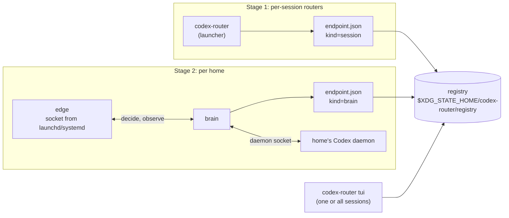

# Multi-session codex-router

## Overview

The user runs 1-20 Codex agents at once, in different git worktrees and projects, under two
Codex homes: `~/.codex` (personal account) and `CODEX_HOME=~/.codex-work` (work account). Today
each `codex-router` run serves one Codex session, and `codex-router tui` attaches to the newest
one only.

This plan delivers, in one run:

- **Stage 1.** A session registry and a multi-session TUI on top of today's per-session routers.
  `codex-router tui --session X` shows one session with no selection UI. `codex-router tui`
  shows all sessions of all homes: a top bar with `[` `]` and a Sessions tab. Any number of
  panels can be open at once.
- **Gate.** Live spikes for stage 2 on throwaway Codex homes. Stage 2 runs only if they pass.
- **Stage 2.** Per home, a small `edge` (holds the provider port, fail-open relay) and a
  restartable `brain` (engine, classifier, control, footer sync through that home's shared Codex
  daemon). Plain `codex` works. Installed as a Codex plugin plus `codex-router setup`. Runs
  under launchd (macOS) or systemd user units (Linux). The service manager holds the port, so
  an edge crash or upgrade does not free it.
- **Live tests** of both stages with several real Codex instances in agterm.

Design source: the "Один router на много сессий Codex" design note (artifact v2) and the peer
review with Codex on 2026-10-14. Facts about Codex 0.162.1 below are from source reading by two
research agents unless marked **[spike]**.

## Context (from discovery)

- Go module `github.com/alexei-led/codex-router`, Makefile targets `fmt lint test build`
  (`make all`), CI calls make targets.
- `internal/launcher/router.go:45` `codexHome` resolves `CODEX_HOME` (for `models_cache.json`).
- `internal/launcher/runtime.go:29,96` `RuntimeBase` (`XDG_RUNTIME_DIR`/`TMPDIR`) and
  `NewestControlSocket`. Discovery breaks across shells with different `TMPDIR`.
- `internal/control`: JSON-lines socket; `Message{snapshot|ack|error}`; `Handler{Apply,
Snapshot}`. `route.Command{Op, Tier, Preset}` has no target. `route.Snapshot` is one focus
  thread plus engine-wide `Mode`, `Pin`, `Preset`.
- `internal/tui`: Bubble Tea; `Options{Socket, Locate}`; pure `Render`/`RenderPlain` with golden
  files in `internal/tui/testdata`; `scripts/render-docs` renders doc images.
- `route.Engine` implements `proxy.Decider`, `proxy.Observer`, `control.Handler`. The launcher
  wires them. This seam becomes the edge-brain socket in stage 2.
- Live test precedent: `docs/archive/evidence/2026-10-14/live-test-report.md` (agterm splits,
  `agtermctl session text` captures).

Codex facts this plan relies on:

| Fact                                                                                                                                                                                                                                                                                  | Source                                                                                   |
| ------------------------------------------------------------------------------------------------------------------------------------------------------------------------------------------------------------------------------------------------------------------------------------- | ---------------------------------------------------------------------------------------- |
| A plugin can ship skills, hooks, MCP servers, apps. It cannot set `model_provider` or `model_providers.*`.                                                                                                                                                                            | `core-plugins/src/manifest.rs:50-73`, `config/src/types.rs:1035`                         |
| Plugin manifest `.codex-plugin/plugin.json`; marketplace `.agents/plugins/marketplace.json`; install `codex plugin marketplace add owner/repo` then `codex plugin add NAME@MARKETPLACE`.                                                                                              | `core-plugins/src/store.rs:474`, `marketplace.rs:21-24`, `cli/src/marketplace_cmd.rs:66` |
| Hook env has `PLUGIN_ROOT`, `PLUGIN_DATA`; stdin has `cwd`, `session_id`, `model`. On success the process group is not killed; a daemon must redirect stdio. `async: true` exists.                                                                                                    | `hooks/src/engine/command_runner.rs:284,317-339`, `discovery.rs:264-270,533`             |
| Plain `codex` with the provider in `config.toml` runs its thread in the home's shared daemon, with the TUI's cwd. `-c`, `--profile`, `--no-daemon` run embedded.                                                                                                                      | `tui/src/daemon_startup.rs:66-131`, `app_server_session.rs:2300-2311`                    |
| Daemon socket `$CODEX_HOME/app-server-control/app-server-control.sock`, mode 0600, no peer check. `thread/loaded/list`, `thread/resume {excludeTurns}`, `thread/settings/update` (experimental). `thread/started` goes to all clients; `thread/settings/updated` only to subscribers. | `unix_socket.rs:31-71`, `common.rs:552-583,1962`, `outgoing_message.rs:199-207,771-781`  |
| The daemon unloads a thread only when idle with no subscribers: a subscriber must `thread/unsubscribe`.                                                                                                                                                                               | `thread_lifecycle.rs:436`                                                                |
| Each `thread/start` rebuilds config from the home, so a new provider should apply without a daemon restart. **Unverified at runtime.**                                                                                                                                                | `config_manager.rs:429-459`                                                              |
| TUIs reconnect to a restarted daemon (0, 1, 2, 4, then every 8 s) and resume their thread.                                                                                                                                                                                            | `tui/src/app/reconnect.rs:30-80`                                                         |
| Provider `base_url` is TCP only in 0.162.1 (no unix socket).                                                                                                                                                                                                                          | `model-provider-info/src/lib.rs`, Codex peer                                             |
| A dead provider port: the turn retries forever ("Reconnecting… waiting for network", 5 s doubling to 60 s) and resumes when the port listens again.                                                                                                                                   | `core/src/responses_retry.rs:93-118`, spike 1b **[spike]**                               |

## Development Approach

- **testing approach**: Regular (code first, then tests in the same task).
- complete each task fully before moving to the next; small, focused changes.
- **CRITICAL: every task MUST include new/updated tests** for code changes in that task: success
  and error paths, table-driven where inputs form a matrix. Mock only boundaries (filesystem,
  process, clock, network, `launchctl`/`systemctl`).
- **CRITICAL: all tests must pass before starting the next task**: `make fmt lint test build`.
- **CRITICAL: update this plan file when scope changes during implementation.**
- No backward-compatibility shims: the control protocol, TUI and hook change together.
- Never print or log header values, tokens, auth, or request/response text.

## Testing Strategy

- **unit tests**: required in every task (see above). Golden render tests for every new TUI view
  (`RenderPlain` into `internal/tui/testdata`, width 80 and 140).
- **integration tests** (normal `go test`): fake Codex app-server and fake daemon over a unix
  socket (pattern: `internal/launcher/fakecodex_test.go`); edge with `LISTEN_FDS` via a child
  process; registry with several endpoints.
- **live tests** (Tasks 12, 23): real Codex 0.162.1 in agterm, driven by `agtermctl`. Evidence
  in `docs/archive/evidence/<run-date>-multi-session/`. Not part of `make test`.

## Progress Tracking

- mark completed items with `[x]` immediately when done.
- add newly discovered tasks with ➕ prefix; document issues/blockers with ⚠️ prefix.
- live tests: each bug found gets a fix commit and a regression test, recorded in the stage's
  evidence report like the 2026-10-14 report.

## Workflow Execution Notes

- Task order is the dependency order. `Depends on` lines list hard dependencies. Only tasks
  marked **parallel group** may run at the same time; their Files blocks do not overlap. Every
  other task runs alone. Stage 2 tasks 15-22 run strictly in sequence (they share `route`,
  `proxy` and `cmd/codex-router/main.go`).
- **[live]** tasks need agterm, a real Codex, real accounts and the classifier key. They run
  serially, in the main checkout (not a worktree agent), one at a time.
- **Gate (Task 14)** decides stage 2. If any gate criterion fails, the workflow stops after
  writing the gate report. It does not start Task 15.
- Safety rules for every task and agent:
  - Never edit `~/.codex/config.toml` or `~/.codex-work/config.toml`, never install plugins or
    hooks into those homes, never copy their `auth.json`, and never stop, restart or connect
    to the user's shared daemons. (Codex itself writes rollouts, sqlite and token refreshes
    into a home it runs in; that is expected.)
  - Stage 1 live runs use the real homes through the launcher (`-c` overrides, private
    app-server), as the 2026-10-14 live test did.
  - Stage 2 runs use two dedicated **test homes** only: `~/.cache/codex-router-live/home-a` and
    `home-b`, each logged in once by the user with `codex login` (Task 13). Copying `auth.json`
    is forbidden: ChatGPT refresh tokens rotate, so a refresh in a copy logs the real home out.
  - Each live task asserts that the real `config.toml` files are unchanged (sha256 before and
    after) and runs with a temp `XDG_STATE_HOME` so its registry and state never mix with the
    user's.
  - Any cleanup that stops a daemon or deletes a dir first checks that the target path is under
    `~/.cache/codex-router-live/` or the run's `mktemp` prefix, and refuses otherwise.
  - Never run `codex-router setup` against a real home in this plan.

## Solution Overview



Key decisions:

| #   | Decision                                                                                                                                                                                                                                                                                                                                                                                                                                                                               | Reason                                                                                                                                                                                                                                                                                        |
| --- | -------------------------------------------------------------------------------------------------------------------------------------------------------------------------------------------------------------------------------------------------------------------------------------------------------------------------------------------------------------------------------------------------------------------------------------------------------------------------------------- | --------------------------------------------------------------------------------------------------------------------------------------------------------------------------------------------------------------------------------------------------------------------------------------------- |
| M1  | **Session** = one Codex main thread, identity `(home_id, thread_id)`. Label `home · repo · branch` (+ 4-hex id suffix on collision) is display only.                                                                                                                                                                                                                                                                                                                                   | Same identity in both stages. `/new` in Codex is a new session. Codex peer: never key on `thread_id` alone.                                                                                                                                                                                   |
| M2  | `home_id` = first 12 hex of sha256 of the canonical `CODEX_HOME` path. Home name: `.codex` → `default`, `.codex-<x>` → `<x>`, else the basename.                                                                                                                                                                                                                                                                                                                                       | Stable, no setup needed, no config field.                                                                                                                                                                                                                                                     |
| M3  | Registry root `$XDG_STATE_HOME/codex-router/registry` (else `~/.local/state/...`), dir 0700, files 0600, atomic replace. An entry is a hint; a `hello` handshake confirms `endpoint_id` and `home_id`. Dead entries are pruned by readers. Service units get the resolved state dir as an explicit `--state-dir` flag, because launchd and systemd do not see the shell's `XDG_STATE_HOME`.                                                                                            | Shared by all shells regardless of `TMPDIR`. Codex peer review; plan review.                                                                                                                                                                                                                  |
| M4  | Control protocol v2: `hello`, `sessions` (list push), `subscribe {session}`, per-session snapshots, commands with `session` and `id`. The ack carries the id so `Send` can match it. Last-write-wins. No dedupe cache, no stale-revision rejects, no cross-panel event line in v1.                                                                                                                                                                                                     | Multi-panel, multi-session. Nothing retries commands, and one user with a few panels does not need optimistic concurrency. Upgrade trigger: lost-update or double-apply bugs.                                                                                                                 |
| M5  | Pause and pin are per thread. Pause also exists per home (engine-wide). Preset is per home. Manual hold stays per thread. No cross-home pause. The TUI sends a `scope=home` command to **every** endpoint of the focused home, and each endpoint applies it to its own threads, whatever its kind.                                                                                                                                                                                     | User asked for per-session control. One code path for stage 1 sessions and stage 2 brains. Codex peer review; plan review.                                                                                                                                                                    |
| M6  | Stage 2: one edge + one brain **per home**, separate port, token, state, units. No shared brain across homes.                                                                                                                                                                                                                                                                                                                                                                          | Isolates accounts, daemon connections and restarts. Codex peer review.                                                                                                                                                                                                                        |
| M7  | Edge-brain link: unix socket `$STATE/codex-router/homes/<home_id>/brain.sock` (0600), length-prefixed frames: JSON header + raw body. Decide has the existing deadline (classifier timeout + 200 ms); any failure = forward unchanged.                                                                                                                                                                                                                                                 | Reuses `proxy.Decider`/`Observer` 1:1. Bodies stay local; a memcpy per step is cheap.                                                                                                                                                                                                         |
| M8  | The service manager owns the edge's listening socket: systemd `.socket` unit (`LISTEN_FDS`, pure Go) on Linux; launchd `Sockets` + `launch_activate_socket` on macOS via `github.com/ebitengine/purego` (no cgo). Edge without activation (dev) binds itself and warns.                                                                                                                                                                                                                | Port never freed on edge crash or upgrade, so no port-steal window and no reconnect stall. purego keeps `CGO_ENABLED=0` cross-builds. Fallback if the gate spike fails: cgo bridge built on a macOS runner.                                                                                   |
| M9  | Session token: setup writes `http_headers = { "X-Codex-Router-Token" = "<token>" }` into the router provider block, and the token into `$STATE/.../token` (0600) for the edge. Setup refuses a symlinked `config.toml` unless `--follow-symlink`, and sets the file to 0600.                                                                                                                                                                                                           | The daemon does not inherit our env, so `env_http_headers` cannot work. A symlink usually means a dotfiles repo, where a token would get committed.                                                                                                                                           |
| M10 | `config.toml` edits: marked blocks (`# >>> codex-router >>>` … `# <<<`), `model_provider = "router"` inserted before the first table, provider table appended. Validate the result with `github.com/BurntSushi/toml` before writing. Refuse if the user already sets `model_provider`. Timestamped backup 0600. `--undo` removes the blocks.                                                                                                                                           | Minimal, reversible edits that keep the user's comments. A real TOML parser for validation is not a few lines.                                                                                                                                                                                |
| M11 | Brain restart resets learned state (tier, votes, escalation, ledger). On resume the brain seeds each thread's current route from the settings `thread/resume` returns, and holds the thread on that route until its first completed reply measures the cache; then it routes normally. User intent (home pause, thread pause, manual hold, pending pin, preset) is written atomically on change to `intent.json` and reloaded. Unreadable intent: fail open, panel shows `state lost`. | With an empty ledger the engine treats the cache as cold and would switch on one vote, breaking a warm cache. Holding the current route avoids that and a switch back to Codex's native model. Crashes skip SIGTERM handlers, so intent is written on change. Codex peer review; plan review. |
| M12 | Account binding: the proxy puts `account = sha256(ChatGPT-Account-ID)[:12]` in `Meta`, never the raw value. A thread binds to its first account; a different account resets that thread's state. A missing account changes nothing.                                                                                                                                                                                                                                                    | Homes are already isolated (M6); this covers a re-login to another account inside one home. Raw auth-adjacent headers stay upstream-only.                                                                                                                                                     |
| M13 | The stage 1 launcher stays a supported mode (no setup, no config edits). Both modes register in the same registry, and one TUI shows both.                                                                                                                                                                                                                                                                                                                                             | Users who do not want setup keep today's behavior.                                                                                                                                                                                                                                            |

## Technical Details

**Endpoint file** (`registry/<endpoint_id>.json`):

```json
{
  "endpoint_id": "8c1f…",
  "kind": "session",
  "protocol": 2,
  "pid": 4242,
  "started": "…",
  "home": {
    "id": "3fa9c0d1e2b4",
    "path": "/Users/u/.codex-work",
    "name": "work"
  },
  "socket": "/…/control.sock"
}
```

**Control v2 messages** (JSON lines):

- client → server: `{"op":"hello","protocol":2}`,
  `{"op":"subscribe","session":"<home_id>/<thread_id>"}` (empty = sessions list only),
  `{"op":"pin|unpin|pause|resume|preset","session":"…","scope":"session|home","tier":…,"preset":…,"id":"c-…"}`.
- server → client: `hello {endpoint_id, kind, home}`, `sessions {seq, items:[SessionInfo]}`,
  `snapshot {session, snapshot}`, `ack {id}`, `error {id, error}`.
- `SessionInfo`: `id, home, thread_id, label, cwd, mode, tier, route, replies, strip (last 24
tiers), last_switch, last_active, attention (manual|paused|escalation|unknown|state-lost),
footer_synced, saved_usd, spent_usd` (USD fields only when `prices` is configured). Every
  number in `SessionInfo` and `SnapshotFor` comes from that thread's own tallies; home totals in
  the TUI are sums over the home's sessions.
  The list hides a thread idle for 10 min (no user step or reply) unless it is the engine's most
  recently active thread; it leaves at the engine's next push.

**TUI focus rules**: `--session` resolves once (exact id, unique id prefix, unique label or label
suffix; labels match before and after the ` · <4-hex>` disambiguation suffix, so a shared label
names every session that has it). Ambiguous → exit 2 listing candidates; none → exit 1. Locked mode: no top bar, no
Sessions tab; on session end shows `ended` and exits after 3 s. All mode: initial focus = session
whose cwd equals or contains the panel's cwd (deepest match), else the most recently active.

**Keys** (all mode): `[`/`]` previous/next session, `0` Sessions tab, `1-5` tabs, `↑↓`+`enter`
in Sessions, `space` pause/resume focused session, `P` pause/resume focused home, `p` pin next
(focused session), `c` next preset (focused home), `q` quit.

**Stage 2 files**: `$STATE/codex-router/homes/<home_id>/{port,token,intent.json,brain.sock,logs/}`.
If the `brain.sock` path exceeds the unix socket limit (104 bytes on macOS, 108 on Linux), the
brain uses `$TMPDIR/codex-router-<uid>/<home_id>.sock` (0700 parent) and records that path in
the state dir for the edge.
Units: launchd `com.github.alexei-led.codex-router.<home_id>.{edge,brain}`; systemd
`codex-router-edge@<home_id>.{socket,service}`, `codex-router-brain@<home_id>.service`.

## What Goes Where

- **Implementation Steps** (`[ ]`): code, tests, scripts, live runs in agterm, docs.
- **Post-Completion**: Linux live run on a real Linux box, setup on the user's real homes, plugin
  publication.

## Implementation Steps

### Stage 1: registry and multi-session TUI

### Task 1: Home identity package

**parallel group A** · Depends on: none

**Files:**

- Create: `internal/home/home.go`, `internal/home/doc.go`, `internal/home/home_test.go`
- Modify: `internal/launcher/router.go` (use `home.Resolve` instead of `codexHome`)

- [x] `home.Resolve(getenv)` → `Home{ID, Path, Name}` per M2; canonical path via `filepath.EvalSymlinks` with fallback to the cleaned absolute path when the dir does not exist yet
- [x] replace `codexHome` in the launcher; `models_cache.json` path from `Home.Path`
- [x] tests: table for name derivation (`.codex`, `.codex-work`, `codex-x`, trailing slash, relative `CODEX_HOME` rejected), symlinked home gives the same ID, unset `CODEX_HOME` → `~/.codex`
- [x] run `make fmt lint test build`

### Task 2: Session label from cwd

**parallel group A** · Depends on: none

**Files:**

- Create: `internal/home/label.go`, `internal/home/label_test.go`

- [x] `RepoBranch(cwd)` reads `.git` without running git: walk up to `.git` dir or file; worktree `.git` file → `gitdir:` → `commondir` gives the main repo name; branch from `HEAD` (`ref: refs/heads/x` → `x`, detached → short sha)
- [x] `Label(homeName, cwd)` → `home · repo · branch`; non-repo cwd → `home · <dir basename>`
- [x] `Disambiguate([]labels, ids)` appends ` · <4-hex>` to colliding labels
- [x] tests with temp dirs: plain repo, linked worktree, detached HEAD, nested subdir, no repo, unreadable `.git`, collisions
- [x] run `make fmt lint test build`

### Task 3: Registry package

**parallel group A** · Depends on: none

**Files:**

- Create: `internal/registry/registry.go`, `internal/registry/doc.go`, `internal/registry/registry_test.go`

- [x] `Root(getenv)` per M3; create with 0700, refuse a non-dir, a symlink, or a dir not owned by the user (copy the rules of `checkPrivate` from `launcher/runtime.go`; Task 6 switches the launcher to the registry's exported `CheckPrivate` and deletes its copy, so this task does not touch `internal/launcher`)
- [x] `Endpoint` type (Technical Details); `Write` (temp file + rename, 0600), `Remove`, `List` (skip unparseable files, report them as skipped)
- [x] `Prune(isLive func(Endpoint) bool)` removes entries whose socket does not answer and whose pid is gone
- [x] tests: write/list round trip, atomic replace under concurrent writers, bad perms refused, unparseable entry skipped, prune keeps live and drops dead
- [x] ➕ `Alive(Endpoint)`: the default `isLive` for `Prune` (socket answers or pid exists); `Root` also checks the parent `codex-router` dir is private. The not-owned-by-user case is not unit-tested (needs a second uid)
- [x] run `make fmt lint test build`

### Task 4: Engine: per-thread state, pause, pin and snapshots

**parallel group A** · Depends on: none

**Files:**

- Modify: `internal/route/route.go`, `internal/route/control.go`, `internal/route/snapshot.go`, `internal/route/engine.go`
- Create: `internal/route/sessions.go`, `internal/route/sessions_test.go`
- Modify: `internal/route/*_test.go` affected by `Command`/`Snapshot` changes

- [x] move the engine-wide tallies into `thread`: `stats`, `recent` decisions (bounded per thread), `last` decision; drop the global `focus` as the snapshot source (today `route/engine.go:58-68`); engine-wide totals become sums over threads
- [x] `Command` gains `Session` (thread id), `Scope` (`session|home`), `ID`; pause/resume with `Scope=home` keep today's engine-wide behavior; pin requires a thread; preset is home-scoped
- [x] thread state gains `paused` and `pin`; `Decide` honors thread pause and consumes the thread pin under the engine lock (exactly once)
- [x] `SnapshotFor(threadID)` returns today's snapshot for that thread; `Sessions()` returns `[]SessionInfo` (Technical Details) for main threads seen, with `last_active` and attention flags
- [x] `Deps.Cwd func(threadID string) string` feeds `SessionInfo.cwd` (stage 1: the launcher's cwd for all threads)
- [x] tests: interleaved requests from 3 threads keep separate replies, strip, last switch and recent lists (a busy thread never pushes another thread's turns out); thread pause leaves other threads routed; home pause covers all; two pins on one thread → last wins, consumed once by the next turn; pin on thread A never used by thread B; `Sessions()` order and attention flags; existing engine tests updated
- [x] ➕ `Deps.Home`: `Sessions()` fills `id` (`<home_id>/<thread_id>`), `home` and `label` (`home.Label`, outside the engine lock) itself; `Snapshot` gains `ThreadID`
- [x] ➕ no engine-wide tally is left; home totals are sums over `Sessions()`. `Snapshot()` stays for control v1 as the most recently active thread's snapshot, until Task 5 replaces the `Handler`
- [x] ➕ an empty `Scope` means `session` when `Session` is set, else `home`. A session command on an unseen thread creates its state, so a pin or pause set before its first step holds; `Sessions()` lists only threads with a user step. Home resume clears manual everywhere and keeps session pauses. Attention covers `paused`, `manual`, `escalation`; `unknown` and `state-lost` come with Task 18
- [x] ➕ the v1 TUI's pin/unpin and `launcher/fakecodex_test.go` send the snapshot's thread, since the engine now rejects a pin without a session
- [x] run `make fmt lint test build`

### Task 5: Control protocol v2

Depends on: Task 4

**Files:**

- Modify: `internal/control/control.go`, `internal/control/server.go`, `internal/control/client.go`
- Modify: `internal/control/*_test.go`

- [x] `Handler` becomes `Apply(Command) error`, `Sessions() []SessionInfo`, `SnapshotFor(string) Snapshot`, `Hello() Hello`
- [x] server: `hello` first (reject other first lines and unknown protocol versions with an error line); push the sessions list on change (coalesced, `PublishInterval`); per-connection subscription to one session's snapshots; ack/error carry the command id
- [x] client: `Dial(path)` does the handshake; channels for `Sessions` and `Snapshot`; `Subscribe(session)`; `Send(cmd)` waits for the ack with that id
- [x] tests: handshake, version mismatch, subscription switch, two clients on one session both receive snapshots, ack matched by id with two commands in flight, slow client does not block others
- [x] ➕ wire details: `session` is `<home_id>/<thread_id>`; the server maps it to the thread id and rejects another home's. One publisher goroutine computes pushes, each client has its own writer. The sessions list is pushed only when it changed (`seq` moves). Any command refreshes every subscription (a home command changes all). The `snapshot` op stays: it re-sends the subscribed snapshot (TUI heartbeat). `Send` assigns the id. The client drops snapshots of another session or with an older `Seq`
- [x] ➕ consumers changed only to keep the build green: the launcher passes `Deps.Home` and serves the engine with its hello (endpoint id = runtime id, kind `session`; Task 6 adds the registry entry); the one-session TUI panel subscribes to the most recently active session (Task 7 replaces it); the hook subscribes to its own thread (Task 10 adds the registry lookup); `Engine.Snapshot` moved into the route tests
- [x] run `make fmt lint test build`

### Task 6: Launcher registers its endpoint

Depends on: Tasks 1, 3, 5

**Files:**

- Modify: `internal/launcher/launcher.go`, `internal/launcher/runtime.go`, `internal/launcher/router.go`
- Modify: `internal/launcher/launcher_test.go`, `internal/launcher/session_test.go`, `internal/launcher/e2e_test.go`

- [x] after the control socket is up, write `endpoint.json` (kind `session`, home, socket, pid); remove it on every exit path including fallback
- [x] pass `Deps.Cwd` = launcher cwd; drop `NewestControlSocket` (replaced by the registry in Task 7); use `registry.CheckPrivate` and delete `checkPrivate` from `runtime.go`
- [x] tests: entry exists while running and is gone after exit; startup failure leaves no entry; e2e with the fake Codex sees `hello` with the right home
- [x] ➕ a registry that cannot be written does not stop the session: it routes, logs `registry-write-failed` and prints one stderr line that the panel will not list it. `session.close` removes the entry first, so every exit path (fallback, signal during startup, codex exit) drops it
- [x] ➕ `cmd/codex-router/main.go` (outside the Files list, to keep the build green): `tui` without `--socket` locates the newest live registry endpoint instead of `NewestControlSocket`, until Task 7 replaces it with the fleet
- [x] run `make fmt lint test build`

### Task 7: TUI fleet client

Depends on: Tasks 2, 3, 5, 6

**Files:**

- Create: `internal/tui/fleet.go`, `internal/tui/fleet_test.go`
- Modify: `internal/tui/tui.go`, `internal/tui/model.go`

- [x] fleet watches the registry (poll 1 s), dials each endpoint, prunes dead entries, merges `SessionInfo` from all endpoints, groups by home, applies `Disambiguate`
- [x] focus model per Technical Details: locked (`--session`) vs all; initial focus by panel cwd, else most recent; focus survives list reorders by session id
- [x] lost endpoint → its sessions show `disconnected`, then are removed after 10 s; redial when the entry reappears
- [x] `P` and `c` (preset) send one `scope=home` command to every endpoint of the focused home (M5); no branch on endpoint kind
- [x] tests with fake endpoints: merge and grouping, focus by cwd (deepest match), locked mode ignores other sessions, endpoint loss and return, home-scoped pause and preset reach every endpoint of the focused home and none of the other home
- [x] ➕ dead entries are pruned only after a failed dial (`registry.Alive` then `Remove`), so the 1 s poll does not dial every live socket twice. A hello whose endpoint or home differs from the entry is dropped. An initial pick of the most recent session stays provisional until every connected endpoint has sent its first list, and a later cwd match replaces a most-recent pick (never a cwd pick)
- [x] ➕ `space` now pauses/resumes the focused session (it sent a home pause to one endpoint, against M5); `P` is new. `Options` is `{Socket, Registry, Session}`: `Session` locks the panel (Task 9 adds the flag), `--socket` bypasses the registry
- [x] ➕ `cmd/codex-router/main.go` (outside the Files list): `tui` passes the registry root and no longer fails when no session runs; `newestSession` and its test are gone. `docs/user-guide.md` lines on the newest-session panel and home-wide `space` stay stale until Task 11
- [x] run `make fmt lint test build`

### Task 8: TUI views: top bar, Sessions tab, locked header

Depends on: Task 7

**Files:**

- Modify: `internal/tui/render.go`, `internal/tui/model.go`, `internal/tui/tui.go`
- Create: `internal/tui/sessions.go` (rendering), golden files in `internal/tui/testdata/`
- Modify: `internal/tui/tui_test.go`

- [x] top bar: `◂ <focused label> <others…> ▸ i/n` with home dot color and attention marks (`◐` manual, `‖` paused, `↑` escalation, `?` unknown); truncates with `…` to width
- [x] Sessions tab `0`: grouped by home; columns SESSION, STATE, ROUTE, REPLIES strip, LAST SWITCH; home header with endpoint state and the home's totals (sum of its sessions: replies, switches, saved USD when priced); below 100 columns drop REPLIES and LAST SWITCH
- [x] locked header: one line `● home · repo · branch  <id>`; no bar, no tab 0; `ended` state
- [x] keys per Technical Details
- [x] golden tests: all mode with 5 sessions in 2 homes (80 and 140 cols), locked mode, ended, disconnected, empty registry, 20 sessions (scroll)
- [x] ➕ `SessionInfo` gains `switches` (`internal/route/sessions.go`, outside the Files list) for the home totals. The top bar shows `?` for any attention the panel does not know, so Task 18's `unknown` and `state-lost` need no TUI change
- [x] ➕ `fleet.go` (outside the Files list): `focusOn` for `[`/`]` and `enter`; a chosen focus is never replaced by a cwd match. Locked `ended`: the session was listed and now no endpoint lists it, or its endpoint is lost and its registry entry is gone (the launcher removes its entry first on exit), so `ended` shows within one poll, not after the 10 s grace. The panel quits 3 s later unless the session came back
- [x] ➕ the Sessions tab scrolls to keep the `↑↓` cursor in view (`↑ N more`/`↓ N more`), using the terminal height; `enter` focuses the cursor's session and opens Now. With no session at all the header reads `no sessions` instead of `disconnected`. Key hints wrap at the width. `Render`/`RenderPlain` (docs images, old goldens) stay a bare snapshot with no bar
- [x] run `make fmt lint test build`

### Task 9: CLI: `tui --session`, `sessions`

Depends on: Task 8

**Files:**

- Modify: `cmd/codex-router/main.go`, `cmd/codex-router/main_test.go`

- [x] `codex-router tui [--session ID|LABEL] [--socket PATH]`; resolution rules and exit codes per Technical Details
- [x] `codex-router sessions [--json]`: one line per session (`id  home  label  mode  route`), `--json` prints `[]SessionInfo` with endpoint id; used by live tests and scripts
- [x] tests: exact id, prefix, label, ambiguous (exit 2 with candidates), not found (exit 1), `--socket` bypasses the registry, `sessions --json` shape
- [x] ➕ an id also matches the bare thread id (what Codex shows), exact or prefix; a cross-home match is ambiguous (M1). A label suffix must start at a `·`, so `main` names the branch but `ain` matches nothing. Rules apply in order (id, id prefix, label, label suffix) and the first rule with any match decides. Both commands dial the endpoints once (2 s per endpoint for the first list), skip a stale hello, prune dead entries, and use the panel's order and disambiguated labels. `sessions` has no header line; with no session it prints nothing (`[]` with `--json`). The `--help` text covers both; `docs/user-guide.md` stays for Task 11
- [x] run `make fmt lint test build`

### Task 10: Hook on protocol v2

Depends on: Tasks 1, 3, 5, 9 (runs after Task 9; shares no files with it)

**Files:**

- Modify: `internal/hook/hook.go`, `internal/hook/hook_test.go`

- [x] the hook finds its endpoint: `CODEX_ROUTER_CONTROL` when set (stage 1 launcher), else the registry entries of `home.Resolve(CODEX_HOME)` whose sessions include its thread (stage 2 plain `codex`); whole lookup within the existing 200 ms budget
- [x] the hook dials with `hello`, subscribes to its own thread (hook stdin `session_id` is the thread id, as today) and reports that thread's switch only, from that thread's own recent decisions
- [x] tests: two threads on one endpoint, the hook reports only its own; lookup by registry when the env var is unset; two homes, the hook picks its own; endpoint missing → silent no-op; slow registry stays within budget
- [x] ➕ the registry lookup dials every entry of the hook's home in parallel and takes the first whose hello matches the entry and whose first sessions list has the thread; other homes are never dialed (a thread id may repeat across homes, M1). The hook never prunes. `CODEX_ROUTER_CONTROL` skips the registry and the list check, as before
- [x] run `make fmt lint test build`

### Task 11: Stage 1 docs

Depends on: Tasks 9, 10

**Files:**

- Modify: `docs/user-guide.md`, `docs/architecture.md`, `docs/configuration.md` (if any field changes), `README.md` (one line on multiple sessions)
- Modify: `scripts/render-docs` and `docs/images/` (Sessions tab and top bar images)

- [x] user guide: running several sessions and homes, `tui --session`, all-sessions keys, `sessions`
- [x] architecture: registry, session identity, protocol v2, per-thread pause/pin (mermaid)
- [x] regenerate doc images with the render pipeline
- [x] ➕ `tui.RenderFleet` (`internal/tui/sessions.go`, outside the Files list): the render pipeline can only call exported code, so this draws the all-sessions panel from sample homes and sessions, one endpoint per session; a test checks it matches the panel's own render. New image `router-tui-sessions` (top bar + Sessions tab, 120 columns so the top bar shows several sessions); the per-tab images stay bare snapshots and are unchanged
- [x] ➕ also fixed stale lines outside the new sections: troubleshooting (`no sessions`, registry write failure, ambiguous `--session`, `ended`), exit codes for `tui` and `sessions`, the hook's endpoint lookup, the packages table imports, `configuration.md` env rows and the preset scope line
- [x] run `make fmt lint test build`

### Task 12: [live] Stage 1 in agterm with real Codex

Depends on: Tasks 9, 10

**Files:**

- Create: `scripts/live/stage1.sh` (up/down: throwaway repos and worktrees, agterm workspace, sessions)
- Create: `docs/archive/evidence/<run-date>-multi-session/stage1/` (captures, logs, `report.md`)

- [x] `make build`; record sha256 of both real `config.toml` files; export a temp `XDG_STATE_HOME` for every process the script starts
- [x] `scripts/live/stage1.sh up`: temp repo with 2 worktrees + a second temp repo; agterm workspace `router-live`; 5 sessions via `agtermctl session new --command` (fish login wrapper so the classifier key is in env): 3 × `codex-router` under `~/.codex` (worktree A, worktree B, repo 2), 2 × `CODEX_HOME=~/.codex-work codex-router` (repo 2 worktrees); split in session 1 runs `codex-router tui --session <its label>`; a 6th session runs `codex-router tui`
- [x] checks, each with an `agtermctl session text` capture or log excerpt:
  - `codex-router sessions --json` lists 5 sessions with the right homes and labels
  - all-panel: 2 home groups, `[` `]` cycle all 5, Sessions tab rows match
  - locked panel shows only its session and no bar
  - a prompt in session 1 updates only session 1's row and footer
  - `space` on session 2 pauses only it; `P` on the work home pauses both work sessions only; resume
  - pin from the locked panel and the all-panel on one session: next turn pinned once
  - `/model` in session 3 → `◐ manual` on that row only
  - `kill -9` one router → its row `disconnected`, then gone; others keep routing; registry entry pruned
  - `/new` in session 4 → a new row; the old row leaves after the thread goes idle
- [x] each bug: fix + regression test + entry in the stage report (see ⚠️ below on `report.md`); re-run the failed check
- [x] `scripts/live/stage1.sh down`; assert real `config.toml` sha256 unchanged
- [x] run `make fmt lint test build`
- [x] ➕ bug 1 (`9fbb8b2`): Codex's thread-title side thread (`thread_source = "thread_title"`, `request_kind = "turn"`, no subagent header) was routed and listed as a second session of every router. Requests whose thread source is set and is not `user` now pass through (`internal/responses`, outside the Files list); regression tests `TestClassify`, `TestSideThreadIsNotASession`; architecture and user guide lines updated. Check 1 re-run: 5 sessions
- [x] ➕ `stage1.sh` also has `env`, `capture NAME SESSION [PANE]` (path-sanitized capture) and `focus LABEL` (press `]` in the all-panel until LABEL is focused). Routers get the run's `XDG_RUNTIME_DIR` too, so `down` finds the app-server a `kill -9` orphans by its command line. Codex runs under `/private/tmp`, which the user's config already trusts, so no trust prompt writes `config.toml`
- [x] ➕ the classifier key was not in the fish login env, so all routers ran `Jev off` and turns were routed by pins only; every check above holds with pins. Classifier decisions were not exercised (stage 1 did not change them)
- ⚠️ `stage1/report.md` is not in the repo: the agent harness refuses to write `.md` report files from this workflow. Its text is in the Task 12 stage report; add it as `docs/archive/evidence/2026-10-14-multi-session/stage1/report.md`. Captures and logs are committed. The temp run dirs `/private/tmp/codex-router-live.*` are left behind (deleting them was not permitted); they hold only throwaway repos and logs

### Gate

### Task 13: Spike scripts for stage 2

Depends on: Task 12

**Files:**

- Create: `scripts/spikes/stage2-homes.sh` (test homes check/reset), `scripts/spikes/stage2/daemon_test.go` (build tag `live`), `scripts/spikes/activation/` (its own `go.mod`, so purego stays out of the main module until Task 16; minimal edge, plist, units)

- [x] test homes `~/.cache/codex-router-live/home-a` and `home-b` (0700). The script checks each has a valid login (`CODEX_HOME=<home> codex login status`). **If not logged in: stop the workflow and ask the user to run `! CODEX_HOME=~/.cache/codex-router-live/home-a codex login` (and `home-b`, ideally with the work account) once.** Never copy `auth.json`
- [x] `reset`: rewrite only `config.toml` in a test home (minimal, router provider pointing at a spike proxy `codex-router proxy`); trap cleanup stops the test home's daemon (`CODEX_HOME=<home> codex app-server daemon stop`) after the path guard from the safety rules
- [x] daemon client spike (Go, tag `live`) using `internal/appserver` against `<home>/app-server-control/app-server-control.sock`
- [x] activation spike: launchd plist with `Sockets`, a tiny Go binary that gets the fd through purego `launch_activate_socket`
- [x] no access to real homes beyond the sha256 checks
- [x] run `make fmt lint test build` (the `live` tag and the separate module keep the spikes out of normal lint and test)
- [x] ➕ `stage2-homes.sh` commands: `check` (exit 3 with the login commands when a home is not logged in), `reset a|b [PORT [TOKEN_FILE]]` (empty config, or the router provider, with the `http_headers` token for G3), `serve a|b [PORT]` (`codex-router proxy` with the test home as `CODEX_HOME`, config pointed at it; the EXIT trap stops the proxy and the home's daemon and compares the real `config.toml` sha256s), `stop a|b`. `stop` also ends the managed daemon's `pid-update-loop`, which outlives `daemon stop`
- [x] ➕ the activation spike edge (`scripts/spikes/activation/`, module with purego v0.11.1) relays to an upstream `codex-router proxy` and requires the token (logs `token=ok|missing|wrong`, never the value), so G3 and G4 can run real Codex turns through it; `/spike?delay=MS` answers with its pid. `spike.sh up|probe|stall|kill|down` loads the agent from `~/.cache/codex-router-live/activation` with `launchctl bootstrap` (nothing installed in `~/Library/LaunchAgents`). systemd `.socket`/`.service` files are templates for Task 16, not run
- [x] ➕ smoke runs (test home A only; real `config.toml` sha256s unchanged): activation works with `CGO_ENABLED=0`; `spike.sh stall` served the next request 32 ms after a `kill -9`. Daemon spike over the real daemon socket: WebSocket transport and `initialize` work; `thread/started` reaches other clients; `thread/loaded/list` + `thread/read` give cwd. Findings for Tasks 14 and 17: the socket path is a symlink into `/private/tmp/codex-daemon-<uid>/`; `thread/resume` fails with -32600 (no rollout) until a thread's first turn; `thread/settings/update` on an unresumed thread applies but `thread/settings/updated` reaches only subscribers. G1 must prompt each TUI before resuming

### Task 14: [live] Gate run and decision

Depends on: Task 13

**Files:**

- Create: `docs/archive/evidence/<run-date>-multi-session/gate/report.md`
- Modify: this plan (Gate outcome section)

- [x] G1: two plain `codex` TUIs in agterm with `CODEX_HOME=<home-a>`; spike client sees both threads in `thread/loaded/list` with their cwd; `thread/resume` returns current settings; `thread/resume` + `thread/settings/update` repaints both footers
- [x] G2: provider block added to `<home-a>/config.toml` while its daemon runs; a new thread uses the router without a daemon restart (if not: setup must restart the daemon; record and continue only if a restart is safe for other sessions)
- [x] G3: a static `http_headers` token in the provider reaches the spike proxy
- [x] G4: macOS activation: launchd holds the port; `kill -9` the spike edge mid-request; the next connection waits in the backlog and is served by the restarted edge; measure the stall. Linux part: unit test with `LISTEN_FDS` (Task 16) stands in
- [x] G5: a local plugin marketplace in `<home-a>` with a SessionStart hook: hook env has `CODEX_HOME` (or it can be derived), a detached child survives the hook; a hook command can reach the registry (Task 10 lookup)
- [x] write the gate report and the Gate outcome section. **If G1, G3, G4 or G5 fails: stop the workflow here.** G4 failing with purego but passing with a cgo bridge: switch M8 to cgo + macOS release runner (add ➕ task to the release workflow) and continue
- [x] cleanup (test homes stay, logged in, for Task 23); real `config.toml` sha256 unchanged
- [x] ➕ `scripts/spikes/plugin/`: local marketplace (`.agents/plugins/marketplace.json`) with the `router-gate` plugin, whose SessionStart hook `gate-hook.sh` writes a report to `$PLUGIN_DATA/gate/` (selected env names only, input keys, a detached `sleep` child, and `codex-router sessions --json` + `codex-router hook` only when `XDG_STATE_HOME` is a gate run's temp dir, so the user's registry is never read or pruned). It needs `CODEX_ROUTER_BIN` in the daemon's env: `codex-router` is not on the hook's PATH
- ⚠️ `gate/report.md` is not in the repo, for the same reason as `stage1/report.md` (the agent harness refuses `.md` report files). The report is the Gate outcome section below; captures and logs are committed under `docs/archive/evidence/2026-10-14-multi-session/gate/`. The temp run dirs `/private/tmp/codex-router-gate.mESXcC` and `/private/tmp/codex-router-spike.7yKZGY` are left behind (logs and a throwaway token only)

#### Gate outcome

**Passed: G1-G5 all pass (2026-10-14, Codex 0.162.1, test home A only). Stage 2 proceeds; M8 stays
purego (no cgo fallback).** Real `~/.codex/config.toml` and `~/.codex-work/config.toml` sha256
unchanged (`c409e1eb…1486` both, before and after); every process ran with
`XDG_STATE_HOME=/private/tmp/codex-router-gate.*/state`; the user's daemons were not touched. No
codex-router bugs found, so no fix commits. Evidence: `docs/archive/evidence/2026-10-14-multi-session/gate/`.

| Gate | Result | What happened                                                                                                                                                                                                                                                                                                                                                                                                                                                                                                                                                           | Evidence                                                                                                              |
| ---- | ------ | ----------------------------------------------------------------------------------------------------------------------------------------------------------------------------------------------------------------------------------------------------------------------------------------------------------------------------------------------------------------------------------------------------------------------------------------------------------------------------------------------------------------------------------------------------------------------- | --------------------------------------------------------------------------------------------------------------------- |
| G1   | pass   | Two plain `codex` TUIs (cwd `w1`, `w2`) shared one home-a daemon. `thread/loaded/list` + `thread/read` gave both main threads with their cwd (plus two ephemeral `thread_title` side threads, filtered out). `thread/resume {excludeTurns}` returned model and cwd. `thread/settings/update` to `gpt-6-luna · low` repainted both footers at once.                                                                                                                                                                                                                      | `g1-loaded-resume.txt`, `g1-settings-update.txt`, `g1-tui{1,2}-after-update.txt`                                      |
| G2   | pass   | `stage2-homes.sh serve a` wrote the router provider into `config.toml` while daemon pid 49013 ran. `/new` + a prompt in TUI 1 went through the proxy (`responses` 200 for the main thread and its title side thread); the daemon pid stayed 49013. The new thread reports `provider=router`; threads started earlier keep `provider=openai`.                                                                                                                                                                                                                            | `g2-loaded-after-provider.txt`, `g2-tui1-new-thread.txt`, `g2-g4-proxy.txt`                                           |
| G3   | pass   | Spike edge (launchd, token file) in front of the proxy; `reset a 53611 TOKEN_FILE` put `http_headers = { "X-Codex-Router-Token" = … }` into the provider. `/new` + a prompt in TUI 2: edge logged `token=ok` for both `/v1/responses` requests; curl without or with a wrong token got 401 (`token=missing`, `token=wrong`).                                                                                                                                                                                                                                            | `g3-g4-edge.txt`, `g3-tui2-token-turn.txt`                                                                            |
| G4   | pass   | Edge built with `CGO_ENABLED=0` (purego `launch_activate_socket`). `spike.sh stall` × 3: the request in flight got an empty reply; the next request, sent right after `kill -9`, was served by a new edge pid in **18 ms, 35 ms, 18 ms**. Real turn: `kill -9` while Codex streamed "1 to 300 as words"; Codex retried ~0.9 s later, the restarted edge served it and the turn completed (proxy: `stream-aborted`, then the same turn `responses` 200).                                                                                                                 | `g4-stall.txt`, `g3-g4-edge.txt`, `g4-tui2-turn-across-kill.txt`, `g2-g4-proxy.txt`                                   |
| G5   | pass   | `codex plugin marketplace add scripts/spikes/plugin` + `codex plugin add router-gate@router-gate` in home-a. The hook ran only after trusting it in `/hooks` (`t`). In the daemon: `CODEX_HOME`, `PLUGIN_ROOT`, `PLUGIN_DATA` set (home also derivable from `PLUGIN_ROOT`); the `sleep` child (stdio to `/dev/null`) was alive with ppid 1 minutes later; `codex-router sessions --json` from the hook listed the home-a launcher session through the registry (hello checked); `codex-router hook` printed `{}` (no endpoint routes a daemon thread yet) in under 1 s. | `g5-hook-daemon-run{1,2}.txt`, `g5-hook-launcher.txt`, `g5-detached-children.txt`, `g5-hooks-review-before-trust.txt` |

Findings that later tasks must use:

- **Daemon env = env of the TUI that started it** (`ps eww`: `XDG_STATE_HOME`, `CODEX_HOME`,
  `TMPDIR`); a plugin hook gets that env plus `PLUGIN_ROOT`, `PLUGIN_DATA`, and runs under the
  user's `$SHELL -lc` (fish here). So the hook's registry root depends on the shell that started
  the daemon, and `codex-router` is not on its PATH. Task 21: the hook must not rely on PATH or
  `XDG_STATE_HOME`; setup should record the binary and state dir where the hook can read them
  (e.g. `PLUGIN_DATA`). (Tasks 20, 21)
- **Plugin hooks need one-time trust**: until the user presses `t` in `/hooks`, the hook does not
  run. Trust is written by Codex to the home's `config.toml` as
  `[hooks.state."<plugin>@<marketplace>:hooks/hooks.json:session_start:0:0"] trusted_hash = "sha256:…"`
  and is tied to the hook's hash, so changing the hook command asks again. Setup must not write
  that hash itself; docs tell the user to trust it. (Tasks 20, 21, 25)
- **SessionStart timing**: on `/new` it fired when the thread started; for the TUI's first thread
  it fired at the first prompt (that thread starts lazily). Hook input keys: `cwd`,
  `hook_event_name`, `model`, `permission_mode`, `session_id`, `source`, `transcript_path`.
- **A provider change applies to new threads only**: running threads keep the provider they
  started with until `/new` or a restart. Setup and docs must say so. (Tasks 20, 25)
- **`thread/resume` returns an empty effort** when the thread uses the model's default effort
  (footer "default"); the brain must seed that as "model default", not as a missing route.
  (Tasks 17, 18)
- `thread/settings/updated` carries the full thread settings, including developer instructions;
  the brain must not log the payload. (Task 17)
- After `/new` the previous thread stayed in `thread/loaded/list` for the rest of the run; the
  brain's idle rule (10 min) must not assume the daemon unloads it quickly. (Task 17)
- The spike plist sets `ThrottleInterval` 1; with kills 3-4 s apart launchd never throttled.
  Crash loops faster than that were not tested. **Unverified:** whether Codex re-rendered the
  partial reply after the retry (only the screen tail was captured).
- The detached child in G5 redirected stdio, per the Codex source; a child that keeps the hook's
  stdout open was not tested (the source says the hook then waits until its timeout).

Cleanup: agterm workspace `router-gate` deleted; launchd spike agent booted out; proxy, test
daemon and its `pid-update-loop` stopped; detached children killed; plugin and marketplace
removed and `home-a/config.toml` reset to empty; both test homes still logged in.

### Stage 2: per-home edge and brain

### Task 15: Edge-brain link package

Depends on: Task 14 (gate passed)

**Files:**

- Create: `internal/link/link.go`, `internal/link/client.go`, `internal/link/server.go`, `internal/link/doc.go`, `internal/link/link_test.go`

- [x] frame format per M7 (4-byte length + JSON header + body); messages `hello{home_id}`, `decide`, `rewrite|none`, `observe`
- [x] client implements `proxy.Decider` and `proxy.Observer`: deadline per call, reconnect with backoff, breaker; every failure returns "no rewrite"; `observe` is fire-and-forget with a bounded queue (drop when full)
- [x] server wraps a `route.Engine`; checks `home_id` in `hello`; socket 0600 in a 0700 dir
- [x] the decide header carries `Meta`, which holds only the account hash once Task 19 lands (no raw headers in frames)
- [x] tests: round trip, brain down → pass-through within the deadline, brain slow → pass-through, brain restart → client reconnects, wrong home rejected, 32 MiB body, observe queue full does not block
- [x] run `make fmt lint test build`
- [x] ➕ `responses.Request.Body()` returns the parsed raw body, so the client sends it without a re-encode (touches `internal/responses/request.go`). Frame: uint32 length, header JSON line, body; a decide carries `timeout_ms` (the edge's remaining wait) so the brain decides under the same deadline as in process. Client rules: dial + hello bounded by 200 ms, redial backoff 50 ms doubling to 2 s, breaker opens for 10 s after 3 decide timeouts in a row, observe queue 256. A `*route.Engine` satisfies `link.Handler` (compile check in the test)

### Task 16: Socket activation and `codex-router edge`

Depends on: Task 15

**Files:**

- Create: `internal/listen/listen.go`, `internal/listen/systemd.go`, `internal/listen/launchd_darwin.go`, `internal/listen/launchd_other.go`, `internal/listen/listen_test.go`
- Modify: `cmd/codex-router/main.go`, `cmd/codex-router/main_test.go`, `internal/proxy/proxy.go` and its tests (accept an external listener), `internal/launcher/router.go` (shared proxy wiring if reused)
- Modify: `go.mod`, `go.sum` (`github.com/ebitengine/purego`, unless the gate switched to cgo)

- [x] `listen.Activated(name)`: systemd `LISTEN_PID`/`LISTEN_FDS`/`LISTEN_FDNAMES` (pure Go, clears the env after use); launchd via `launch_activate_socket`; neither → `ErrNotActivated`
- [x] `codex-router edge --home PATH --state-dir DIR`: listener from activation, else self-bind on the stored port with a warning; token from state; proxy with the link client; `/healthz` reports `brain: up|down`
- [x] tests: systemd path in a child process with fd 3 and `LISTEN_FDS=1` (runs on Linux and macOS); wrong `LISTEN_PID` ignored; edge with brain down forwards unchanged (fake upstream); token required
- [x] run `make fmt lint test build`
- [x] ➕ layout and names the edge reads (setup in Task 20 must write the same): `--state-dir` is the base the units pass, as `$XDG_STATE_HOME`; home state `<state-dir>/codex-router/homes/<home_id>/` with `port` and `token` (plain text, trailing newline ok). `codex-router/`, `homes/` and the home dir must be 0700 and owned by the user, else the edge refuses to start. Socket name `edge` for both the launchd `Sockets` key and the systemd `FileDescriptorName` (systemd always sets `LISTEN_FDNAMES`). Constants live in `cmd/codex-router/main.go` until setup needs them
- [x] ➕ `internal/listen/doc.go` (package doc, as in every package); `registry.StateDir` (the `codex-router` state dir, split out of `registry.Root`); `proxy.Options.Listener` (must be TCP on 127.0.0.1) and `proxy.Options.Health` (extra `/healthz` line); `link.Client.Up` (live connection or a dial now, under the backoff)
- [x] ➕ launchd outside a launchd job returns ESRCH (checked on macOS with cgo and `CGO_ENABLED=0`); ESRCH and ENOENT map to `ErrNotActivated`. A config that does not load makes the edge warn and use defaults: the edge must not leave the port dead

### Task 17: Brain: daemon client and thread tracking

Depends on: Task 16

**Files:**

- Create: `internal/brain/brain.go`, `internal/brain/threads.go`, `internal/brain/doc.go`, `internal/brain/brain_test.go`
- Modify: `internal/appserver/appserver.go`, `internal/appserver/transport.go` and their tests (daemon socket path, `thread/loaded/list`, `thread/read`, `thread/unsubscribe`, `thread/started` handling)
- Modify: `internal/launcher/writer.go` (export the settings writer for reuse, or move it to `internal/brain` and import it back)
- Modify: `cmd/codex-router/main.go`, `cmd/codex-router/main_test.go` (`brain --home PATH --state-dir DIR`)

- [ ] connect to the home's daemon socket with `experimentalApi`; on start `thread/loaded/list` and resume each main thread (skip ephemeral and subagent threads); on `thread/started` resume the new thread; cwd per thread feeds `Deps.Cwd`
- [ ] reuse the settings writer for footer sync; `thread/unsubscribe` when a thread's TUI is gone (no turn and no settings event for 10 min, or the thread reports closed)
- [ ] daemon restart: reconnect with backoff, resubscribe, resync footers
- [ ] serve the link socket and control v2 (kind `brain`), register `endpoint.json`
- [ ] ➕ (from Task 16) the edge dials `<home dir>/brain.sock`; with the long-path fallback (`$TMPDIR/codex-router-<uid>/<home_id>.sock`) the brain records the path and the edge (`cmd/codex-router/main.go`) reads it
- [ ] tests with a fake daemon: two threads resumed, new thread picked up, unsubscribe after idle, daemon restart resync, ephemeral thread skipped
- [ ] run `make fmt lint test build`

### Task 18: Brain intent persistence and restart semantics

Depends on: Task 17

**Files:**

- Create: `internal/brain/intent.go`, `internal/brain/intent_test.go`
- Modify: `internal/route/engine.go`, `internal/route/control.go`, `internal/route/sessions.go` and their tests (seeded-route hold; export/import of intent)

- [ ] M11: intent file written atomically on every intent change; loaded at start; unreadable → fail open + `state lost` finding
- [ ] after a brain start each resumed thread is seeded with the route from `thread/resume` settings and held there (attention `unknown`) until its first completed reply; then normal routing
- [ ] tests: pause/manual/pin/preset survive a restart; learned state does not; seeded thread does not switch before its first measured reply; corrupt file → `state lost` and pass-through; concurrent writes keep the last intent
- [ ] run `make fmt lint test build`

### Task 19: Account binding

Depends on: Task 18

**Files:**

- Modify: `internal/proxy/proxy.go` (hash `ChatGPT-Account-ID` into `Meta.Account`), `internal/responses/` (the file that defines `Meta`), `internal/route/engine.go`
- Modify: matching tests

- [ ] M12 in the proxy (both edge and stage 1 launcher) and the engine
- [ ] tests: thread keeps state with a stable account; a different account resets; a missing account changes nothing; raw header value never appears in Meta, logs or link frames
- [ ] run `make fmt lint test build`

### Task 20: `codex-router setup` and service units

Depends on: Task 19

**Files:**

- Create: `internal/setup/setup.go`, `internal/setup/config_toml.go`, `internal/setup/setup_test.go`, `internal/setup/testdata/`
- Create: `internal/service/service.go`, `internal/service/launchd.go`, `internal/service/systemd.go`, `internal/service/service_test.go`, `internal/service/testdata/`
- Modify: `cmd/codex-router/main.go`, `cmd/codex-router/main_test.go` (`setup`, `service ensure|status`), `go.mod`, `go.sum` (`github.com/BurntSushi/toml`)

- [ ] `setup --home PATH [--dry-run] [--undo] [--follow-symlink]`: print the resolved home first; M9/M10 edits with diff output, backup, validation; pick and store a free port; write token; install and load units for this home only, passing `--home` and the resolved `--state-dir` to both units (M3)
- [ ] `--undo`: remove marked blocks (result equals the backup minus our blocks), unload and delete units, keep state dir unless `--purge`
- [ ] `service ensure`: for `$CODEX_HOME`, start units if set up and down, else print one hint line; returns at once; `service status`
- [ ] `internal/service` runs `launchctl`/`systemctl --user` through an injected runner (mocked in tests); units rendered from templates (golden files)
- [ ] tests: config with comments and tables keeps them; existing `model_provider` refused; symlink refused; dry-run writes nothing; undo round trip byte-identical; two homes get distinct ports, tokens and unit names; unit golden files for both OSes
- [ ] run `make fmt lint test build`

### Task 21: Codex plugin packaging

Depends on: Task 20

**Files:**

- Create: `.agents/plugins/marketplace.json`, `plugins/codex-router/.codex-plugin/plugin.json`, `plugins/codex-router/hooks/` (SessionStart → `codex-router service ensure`, stdio redirected, `async: true`; existing status hook), `plugins/codex-router/skills/router/SKILL.md`
- Modify: `cmd/codex-router/main.go`, `cmd/codex-router/main_test.go` (`ctl status|pause|resume|pin --cwd DIR` for the skill)
- Create: `cmd/codex-router/plugin_test.go` (manifest validation)

- [ ] manifest and marketplace in the formats from Context; the plugin calls `codex-router` from PATH and ships no binary
- [ ] skill: status, pause/resume and pin for the session whose cwd matches, through `codex-router ctl`
- [ ] tests: manifests parse and reference existing files; `ctl` resolves the session by cwd; hook command returns within 1 s when services are down
- [ ] run `make fmt lint test build`

### Task 22: TUI with brain endpoints

Depends on: Task 21 (sequential; needs brain from 17 and intent from 18)

**Files:**

- Modify: `internal/tui/render.go`, `internal/tui/sessions.go`, `internal/tui/fleet.go`, `internal/tui/tui_test.go`, golden files

- [ ] home header shows brain state (`brain up 2h`, `brain down: default model`); `state lost` and `unknown` attention marks
- [ ] mixed fleet: stage 1 sessions and a brain in the same home render in one group
- [ ] golden tests: brain up, brain down, mixed, `state lost`
- [ ] run `make fmt lint test build`

### Task 23: [live] Stage 2 in agterm with real Codex

Depends on: Tasks 20, 21, 22

**Files:**

- Create: `scripts/live/stage2.sh` (temp homes, setup, sessions, cleanup)
- Create: `docs/archive/evidence/<run-date>-multi-session/stage2/` (captures, logs, `report.md`)

- [ ] record real `config.toml` sha256s; temp `XDG_STATE_HOME`; `scripts/live/stage2.sh up`: the two logged-in test homes from Task 13 (reset `config.toml` only), `codex-router setup --home` for each, plugin installed into each from the local marketplace; agterm workspace `router-live-2`: 3 plain `codex` sessions with `CODEX_HOME=<home-a>` (worktrees), 2 with `<home-b>`; one locked panel, one all-panel
- [ ] checks with captures:
  - all 5 sessions appear under 2 homes; footers sync in every TUI
  - `kill -9` brain A mid-turn: no `Reconnecting`, turn completes on the default model; brain A back → routing resumes; a paused session stays paused; home B unaffected throughout
  - `kill -9` edge A mid-turn: port stays bound (`lsof`), turn continues; record the stall
  - brain upgrade simulation (`launchctl kickstart -k`): no turn interrupted
  - temp daemon A restart: brain resyncs footers, sessions keep their labels
  - home isolation: B's threads never appear under A; link frames carry only hashed accounts (log check)
  - `setup --undo` for both homes: configs byte-identical to backups, units gone
- [ ] each bug: fix + regression test + `report.md` entry
- [ ] `scripts/live/stage2.sh down`; real `config.toml` sha256 unchanged; no `codex-router` units left for real homes
- [ ] run `make fmt lint test build`

### Task 24: Verify acceptance criteria

Depends on: Task 23 (or Task 12 when the gate stopped stage 2)

- [ ] every Overview item delivered for the stages that ran; gate outcome recorded
- [ ] edge cases covered by tests: ambiguous labels, 20 sessions, endpoint loss, account change, corrupt intent, symlinked config
- [ ] state plainly in the summary which Linux paths are covered only by unit tests (systemd units, `LISTEN_FDS`, setup on Linux) and which were run live (none in this plan; see Post-Completion)
- [ ] full suite: `make fmt lint test build`; `make vuln`
- [ ] coverage not below the current level (`make coverage`)
- [ ] release cross-build still works: `make release-build`

### Task 25: [Final] Update documentation

Depends on: Task 24

- [ ] README: one picture and three lines for multi-session and setup
- [ ] user guide: setup per home, plugin install, undo, service status, troubleshooting for brain down / edge down / state lost
- [ ] configuration reference: any new fields; architecture: stage 2 diagrams (edge, brain, daemon, units), failure table rows, security (token, account hash, socket activation)
- [ ] evidence reports linked from the architecture doc's further reading
- [ ] move this plan to `docs/archive/plans/`

## Post-Completion

_Items requiring manual intervention or external systems_

**Manual verification:**

- Linux live run on a real Linux box with systemd user units: setup, edge `kill -9` with the
  socket held, brain restart. CI covers the Linux code paths only through unit tests.
- Setup on the user's real homes (`~/.codex`, `~/.codex-work`) when the user decides to switch:
  review the dry-run diff first.

**External system updates:**

- Publish the marketplace by pushing the repo; check `codex plugin marketplace add
alexei-led/codex-router` from a clean machine.
- VS Code extension and the desktop app read the same `config.toml`: check their behavior with
  the router provider (unverified).
