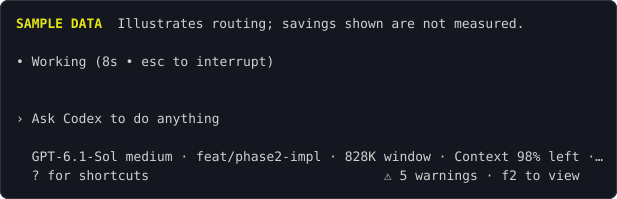
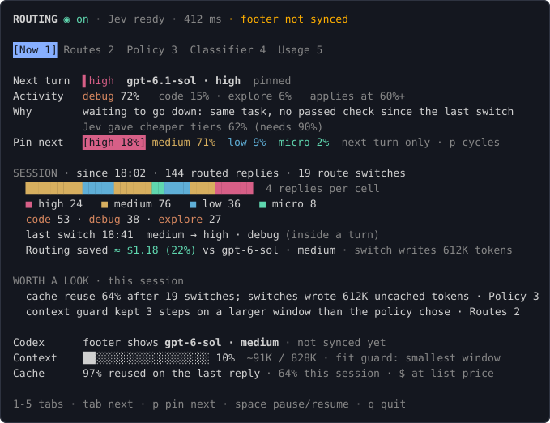
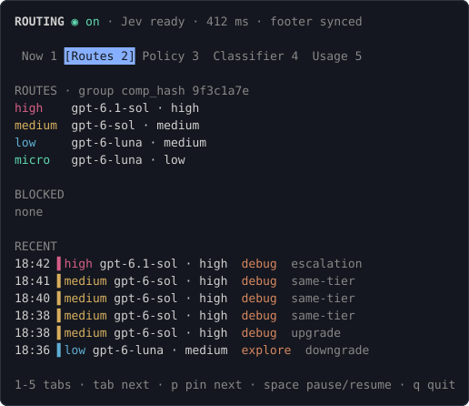
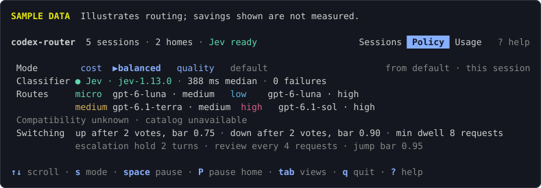
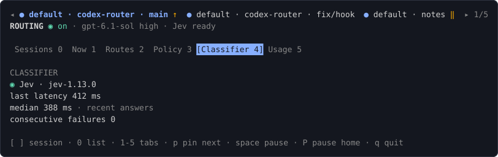
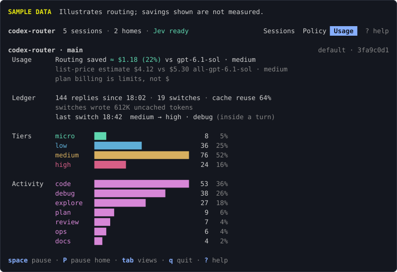

# User guide

Status marks: **[verified]** means checked against a real Codex 0.162.1 in the research spikes ([research §9](research.md)). **[unverified live]** means the code does it and tests cover it, but no live run has confirmed it.

## Launch

```sh
codex-router [--config PATH] [--] [codex args...]
```

Arguments after the router flags go to Codex unchanged. Use `--` when a Codex flag looks like a router flag. Examples:

```sh
codex-router                       # interactive session
codex-router resume --last         # Codex subcommands and flags pass through
codex-router --config ./r.json --  --model gpt-6-sol
```

What it does:

1. Reads the config ([configuration](configuration.md)). Config path order: `--config`, `$CODEX_ROUTER_CONFIG`, `$XDG_CONFIG_HOME/codex-router/config.json`, `~/.config/codex-router/config.json`. A missing file means the defaults.
2. Makes a private runtime dir (`$XDG_RUNTIME_DIR/codex-router/<id>`, else `$TMPDIR/codex-router/<id>`, else `/tmp/codex-router/<id>`; mode `0700`).
3. Starts the proxy on `127.0.0.1` (port from `proxy.port`, default any free port) and probes `/healthz`.
4. Starts a private `codex app-server` on a unix socket in the runtime dir, with `-c` overrides only, and connects to it as a second client.
5. Runs `codex --remote unix://...` on your terminal. The router stays in the foreground process; Codex's exit code is returned (128+N when a signal ended it).

The classifier key comes from the env var named by the classifier's `keyEnv` (`TYPESAFE_API_KEY` for Jev). Unset means the classifier is off for the session.

## Footer

The Codex footer shows the model and effort the router chose, for example `GPT-6-Sol medium`. The router writes every decision to the app-server's thread settings, and the Codex TUI repaints from them **[verified]**, also while a turn runs.



The Codex window and context figures in the footer follow the routed model. The route applies to the next request. Codex starts its next turn natively on that model, so its own context accounting matches.

## Panel

```sh
codex-router tui [--socket PATH]
```

Connects to the newest live session under the runtime base. Pass `--socket` to pick one. It redials with backoff (250 ms up to 2 s) and shows `disconnected` meanwhile. Without `--socket` it looks up the newest live session again on each redial, so it follows a restarted `codex-router`. Commands are refused while disconnected.

Keys:

| Key                | Action                                                  |
| ------------------ | ------------------------------------------------------- |
| `1`-`5`            | Now, Routes, Policy, Classifier, Usage                  |
| `tab`, `shift+tab` | next, previous tab                                      |
| `p`                | pin the next turn: none, high, medium, low, micro, none |
| `space`            | pause routing, or resume                                |
| `c` (Policy tab)   | next preset: thrifty, balanced, quality                 |
| `q`, `ctrl+c`      | quit the panel (the session keeps running)              |

The header shows the mode (`on`, `manual`, `paused`), the classifier state and whether the footer is synced.

### Now



- **Next turn** (or **This turn** mid-turn): tier, model, effort, and the model Codex sent (`base`) when it was rewritten.
- **Activity**: the classifier's activity with its probability, the two likeliest alternates and the probability at which an activity route applies.
- **Why** and a support line: the policy reason and the support it weighed against its bar, plus the uncached tokens a switch writes.
- **Pin next**: one button per tier with the classifier's support. `▶` marks the tier in use.
- **Session**: routed replies as a strip colored by tier (cells merge as it grows), counts by tier and activity, the last switch, and the estimated saving against the baseline model. The saving needs `prices` for both models; without them it says so.
- **Worth a look**: classifier paused or failing, a manual `/model` pick, the context guard keeping a larger window, routes outside the compatibility group, low cache reuse after switches. Each names the tab where you change it.
- **Codex**, **Context**, **Cache**: what the footer shows, how full the smallest window is, and cache reuse for the last reply and the session.

### Routes



The route per tier, the compatibility group (`comp_hash`), models blocked because they are outside the group, and the last six decisions.

### Policy



The preset buttons (`c` cycles) and the thresholds in effect. A preset change applies at once, for this session only; it is not written to the config file.

### Classifier



State, last latency, median of recent answers, consecutive failures, and the pause time when the breaker is open.

### Usage



Requests, switches, cache reuse, the list-price estimate against the baseline (plan billing is usage limits, not dollars), and counts by tier and activity. Session scope only.

## Pin, pause, presets

- **Pin** (`p`): the next turn runs on that tier, whatever the classifier says, and the classifier is not asked. The pin is consumed by that turn. The pinned turn keeps its tier for all its steps.
- **Pause** (`space`): every request goes to Codex's own model unchanged. The router writes the footer back to the model Codex was using.
- **Resume** (`space` again): routing continues, and clears a manual hold.
- **Presets**: `thrifty` makes upgrades harder and downgrades easier, `quality` the reverse, `balanced` uses the policy as configured. Values are in [configuration](configuration.md#presets).

## Picking a model by hand

`/model` in Codex changes the thread settings. The router tells its own writes from yours by matching the value it wrote last. Any other value after its first write is a manual pin. A `/model` pick reaches the router as a settings notification **[verified]**. The thread then goes `manual`: requests keep the model you picked, the panel shows `◐ manual`, and "Worth a look" says so. Press `space` in the panel to resume routing.

## What is never routed

A request is routed only when its `x-codex-turn-metadata` says `request_kind = "turn"`, it has a `turn_id`, and it has no `x-openai-subagent` header **[verified]**. These forward unchanged and make no classifier call:

- compaction (`request_kind = "compaction"`), local or remote
- subagent steps
- anything with missing or unparsable metadata, or a model outside the catalog

Compaction stays local by default. The router resets its vote streak and cache accounting when history shrinks.

## Context-fit guard

A route is used only if the thread's estimated size is at most `policy.contextFill` (default 80%) of that route's window. The size is the larger of the last reply's total tokens and a bytes/4 estimate. The window comes from Codex's model catalog (`models_cache.json`, then `/models` seen by the proxy). An unknown window never fits.

When the chosen tier does not fit, the router takes the lowest tier that does. When none fits, it forwards Codex's own request. When Codex's model does not fit but the baseline does, it moves up to the baseline. It never clips history. Each guard move counts in "Worth a look".

Codex sizes its window from `model_context_window` in `config.toml` if you set it. See the [advice in configuration](configuration.md#model_context_window).

## When things fail

| Failure                           | What happens                                                                                                                                                                    |
| --------------------------------- | ------------------------------------------------------------------------------------------------------------------------------------------------------------------------------- |
| Config file invalid or unreadable | One stderr line with the reason, then plain `codex <args>` replaces the router.                                                                                                 |
| Any startup step fails            | The same fallback.                                                                                                                                                              |
| Classifier key unset              | Classifier off, logged. The router runs; pins work; other turns keep their model.                                                                                               |
| Classifier slow, down or wrong    | The turn is not routed (original model). Each ask has a deadline and two attempts. Three failures in a row pause the classifier for 60 s; the panel and "Worth a look" show it. |
| Router decision error or panic    | The request is forwarded unchanged.                                                                                                                                             |
| Upstream error before any output  | Codex gets a 502 and retries on its own. The proxy never re-sends a request.                                                                                                    |
| Stream cut after output started   | Codex sees a broken stream and keeps the partial output **[verified]**. Nothing is re-sent.                                                                                     |
| Proxy listener stops              | The launcher binds the same port again within about 200 ms. A running turn recovers **[verified]**.                                                                             |
| The router process is killed      | The proxy goes with it, and Codex then has nothing to talk to (a dead listener blocks **[verified]**). Quit Codex and start `codex-router` again.                               |
| Panel loses the router            | It shows `disconnected` and redials. Routing is unaffected.                                                                                                                     |

Ctrl-C and Ctrl-\ reach Codex through the terminal; the router ignores them. SIGTERM and SIGHUP go to Codex.

## Logs

JSON lines, one file per session: `$XDG_STATE_HOME/codex-router/logs/<id>.log`, else `~/.local/state/codex-router/logs/<id>.log`. The directory is `0700`, the file `0600`. `<id>` is the runtime dir name.

Logs hold thread and turn ids, decisions, statuses, sizes and timings. They never hold request or response text, `Authorization` or `ChatGPT-Account-ID`. Nothing is printed to the terminal while Codex owns it. The `proxy` subcommand logs to stderr instead.

## Hook (optional)

The hook prints one line in Codex when the route changed since the previous turn, for example `router: high · debug → gpt-6.1-sol · high · escalate: same tool failure twice, edit in between`. Codex shows it as `↳ Hook · router: ...` (from source, not seen live). The footer already shows the model; the hook adds the reason in the transcript.

`codex-router hook` reads the hook input on stdin, asks the session's control socket (`$CODEX_ROUTER_CONTROL`, set by the launcher) for a snapshot and prints `{"systemMessage": "..."}` or `{}`. It answers within 200 ms and exits 0 even when the router is not running, so it never blocks Codex. It never emits `additionalContext`.

**Trust.** Codex registers hooks passed with `-c` as `untrusted` and does not run them, and it ignores a trust value passed with `-c` **[verified]**. Trust is read only from your persisted `~/.codex/config.toml`. So the router does not register the hook itself. You add it, and you approve it:

1. Add the hook to `~/.codex/config.toml` (TOML form of the verified `-c` syntax; the live run of a persisted entry is **[unverified live]**):

   ```toml
   [[hooks.UserPromptSubmit]]
   [[hooks.UserPromptSubmit.hooks]]
   type = "command"
   command = "/absolute/path/to/codex-router hook"

   [[hooks.Stop]]
   [[hooks.Stop.hooks]]
   type = "command"
   command = "/absolute/path/to/codex-router hook"
   ```

2. Start Codex and trust the hooks through Codex's own hook review. The exact steps are **[unverified live]**; Codex lists them as `untrusted` until a `hooks.state."<key>".trusted_hash` entry exists in your config.
3. Keep the command string stable. Changing it changes the hash and Codex marks the hook `modified`.

For a one-off `codex exec`, Codex has `--dangerously-bypass-hook-trust`. It runs enabled hooks without trust for that run. Use it only for a command you wrote. The router never edits your Codex config.

The live firing of the hook is not verified; see [hook-registration](hook-registration.md) for the spike and a script to check it.

## Proxy for `codex exec`

```sh
codex-router [--config PATH] proxy [--port N]
```

Runs the proxy and routing engine alone, without the app-server, the footer or the panel. It prints the flags that point Codex at it:

```
proxy listening on 127.0.0.1:53211; point codex at it with:
  -c 'model_provider=router'
  -c 'model_providers.router={name="router", base_url="http://127.0.0.1:53211/v1", wire_api="responses", requires_openai_auth=true}'
```

Pass those to `codex exec` in another shell. Routing, pass-through and the fit guard work as in a session. There is no footer sync and no panel. Pins and presets cannot be changed, since no control socket is opened. Logs go to stderr as JSON. Stop with Ctrl-C; the exit code is 0.

## Exit codes

| Command                     | Code                                                                                     |
| --------------------------- | ---------------------------------------------------------------------------------------- |
| `codex-router [codex args]` | Codex's exit code, 128+N for signal N, 1 when neither routed nor plain Codex could start |
| `tui`                       | 0 on quit, 1 on error                                                                    |
| `hook`                      | 0, also when the router is not running; 1 only if stdout fails                                                 |
| `proxy`                     | 0 after SIGINT or SIGTERM, 1 on error                                                    |
| any                         | 2 on a usage error                                                                       |
