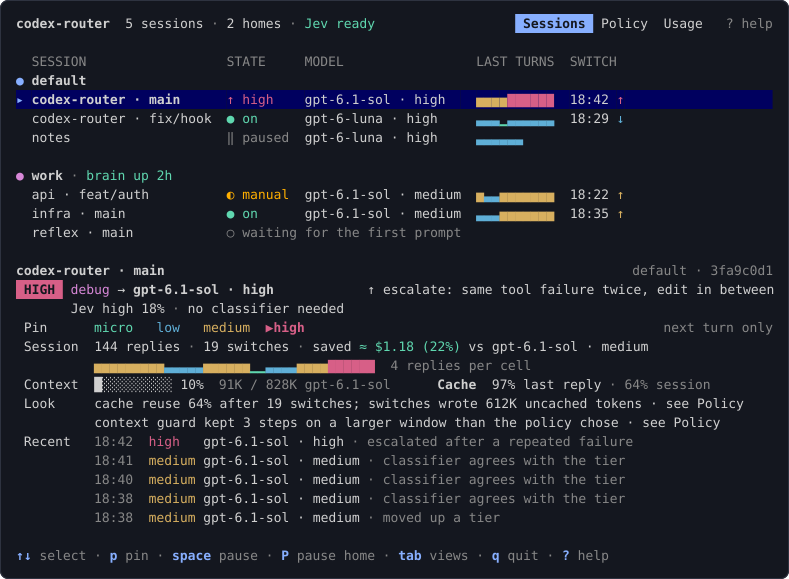
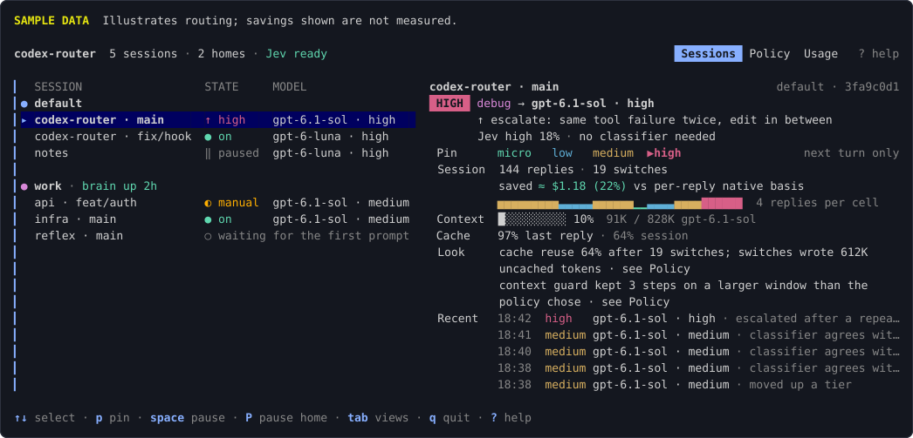
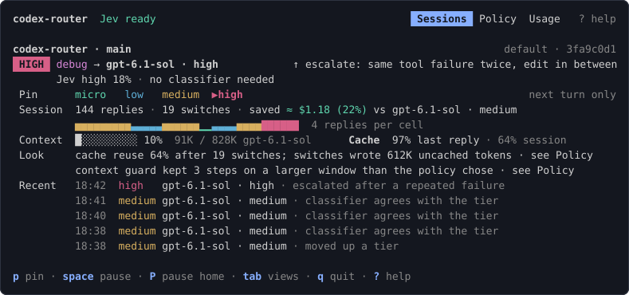
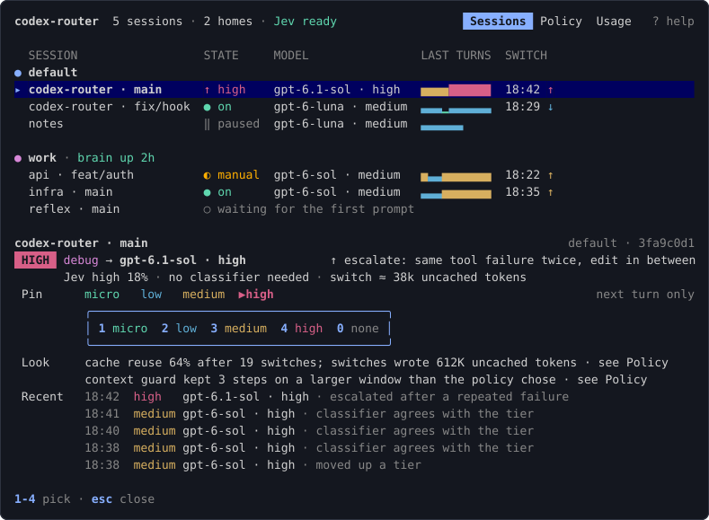
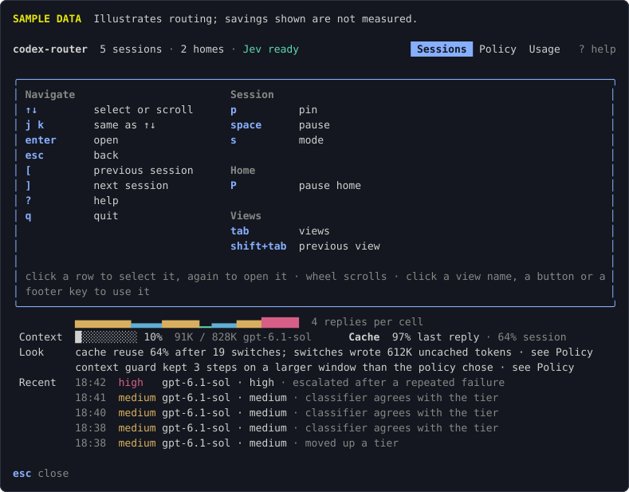

# User guide

Install and use codex-router. Start with [Install](#install) and [First run](#first-run). For individual fields, use the [configuration reference](configuration.md).

[Classifiers and privacy](#choose-a-classifier) · [Panel](#panel) · [Setup](#route-a-whole-home-setup) · [Update or uninstall](#update-or-uninstall) · [Troubleshooting](#troubleshoot)

## Requirements

- macOS or Linux. Windows is not supported.
- The Codex CLI on `PATH`, signed in with ChatGPT. API-key sign-in is not supported, because the router forwards to the ChatGPT backend only. It was tested with Codex 0.162.1. Other versions may work, but the footer sync relies on experimental Codex surfaces (see [Codex versions](#codex-versions)).
- A classifier: a key for the hosted default (Jev), or a local [Ollama](https://ollama.com) model. Without either, the router still runs, but only pins and the context guard change the model.
- For [`codex-router setup`](#route-a-whole-home-setup) only: launchd (macOS) or systemd user units (Linux).

## Install

Prebuilt binaries for macOS and Linux (amd64, arm64) are on the [releases page](https://github.com/alexei-led/codex-router/releases), with a `checksums.txt`.

```sh
os=$(uname -s | tr '[:upper:]' '[:lower:]')                   # darwin or linux
arch=$(uname -m | sed 's/x86_64/amd64/;s/aarch64/arm64/')     # amd64 or arm64
curl -fsSL -o codex-router \
  "https://github.com/alexei-led/codex-router/releases/latest/download/codex-router-$os-$arch"
sudo install -m 0755 codex-router /usr/local/bin/codex-router
codex-router version
```

With Go 1.27.2 or newer:

```sh
go install github.com/alexei-led/codex-router/cmd/codex-router@latest
```

From a checkout, `make build` writes `.bin/codex-router`.

## First run

Choose a classifier first. It rates the work from the clipped prompt and recent dialogue. It does not perform the coding task.

### Hosted: Jev

Jev is a hosted classifier from [Typesafe](https://typesafe.ai). It is the default and needs a separate API key. Your ChatGPT subscription does not supply that key. Prompt text goes to `api.typesafe.ai`.

```sh
export TYPESAFE_API_KEY=your-key
cd your-repo
codex-router
```

Without the key, classification is off. Codex still runs, and pins and the context guard still work.

### Local: Ollama

[Install Ollama](https://ollama.com/download) and start its server. Pull the model, then create a dedicated router config:

```sh
ollama pull qwen3.5:9b
mkdir -p ~/.config/codex-router
printf '%s\n' '{"classifier":"ollama"}' > ~/.config/codex-router/ollama.json
cd your-repo
codex-router --config ~/.config/codex-router/ollama.json
```

This uses the default local endpoint. A custom remote Ollama endpoint sends classifier text to that host. Your normal coding requests go to OpenAI in either mode.

### Check the first turn

Run `codex-router tui` in a second terminal. Submit a prompt in Codex. The panel should show the session, a ready classifier and a decision. The footer shows the model and effort in use. A decision can keep the current route.

If startup fails, the router prints `codex-router: <reason>; running plain codex` and starts plain Codex. If classification is off, check the [troubleshooting table](#troubleshoot).

One panel covers sessions in multiple repos and Codex homes. To route plain `codex`, see [Route a whole home](#route-a-whole-home-setup).

### Pass arguments to Codex

```sh
codex-router [--config PATH] [--] [codex args...]
```

Everything after the router's own flags goes to Codex unchanged. Use `--` when a Codex flag could be taken for a router flag:

```sh
codex-router resume --last
codex-router --config ./router.json -- --model gpt-6.1-sol
```

In this mode, Codex refuses `-s` and `-a` together with `resume` ("Permission overrides are not supported when resuming a remote task"). Drop those flags when you resume.

### What starts

The wrapper starts a local proxy, a private Codex app-server and the Codex TUI. It uses command overrides and does not edit `~/.codex/config.toml`. It returns Codex's exit code. See [architecture](architecture.md#why-a-private-app-server) for the process details.

## Concepts

The router uses these words in the footer, the panel, the config and the docs.

| Term                    | Meaning                                                                                                                                        |
| ----------------------- | ---------------------------------------------------------------------------------------------------------------------------------------------- |
| **Session**             | One Codex conversation (a main thread) routed by codex-router. `/new` in Codex starts a new session.                                           |
| **Home**                | A Codex home (`CODEX_HOME`, default `~/.codex`) with its own login. The panel names it: `~/.codex` is `default`, `~/.codex-work` is `work`.    |
| **Turn**                | One prompt from you. Codex can send several requests for it, called **steps**.                                                                 |
| **Tier**                | The complexity level that the router gives a turn: `micro`, `low`, `medium` or `high`, weakest first.                                          |
| **Route**               | A model and a reasoning effort. Each tier maps to one route (`routes` in the config).                                                          |
| **Classifier**          | A small model that reads your prompt and recent dialogue and returns probabilities for each tier and activity.                                 |
| **Activity**            | The kind of work: `code`, `debug`, `explore`, `plan`, `review`, `ops` or `docs`. An activity can give a tier a different route (`activities`). |
| **Policy**              | The rules that decide when to switch tier. A switch needs enough repeated classifier answers (votes), and costly switches need more support.   |
| **Compatibility group** | Models Codex can switch between in one thread. If the catalog does not list a model, compatibility is unknown and routing keeps the request unchanged.                    |
| **Pin**                 | A tier that you choose in the panel for a session's next turn. The classifier is not asked for that turn.                                      |
| **Pause**               | Routing off for one session, or for every session of a home. Requests go out unchanged.                                                        |
| **Manual hold**         | What a `/model` pick in Codex causes. The router keeps your model for that thread until you resume.                                            |
| **Preset**              | A named set of policy thresholds: `thrifty`, `balanced` or `quality`.                                                                          |
| **Edge**                | After `codex-router setup`: the small service that holds a home's provider port and forwards Codex's requests.                                 |
| **Brain**               | After `codex-router setup`: the service that routes every session of a home. With the brain down, the edge forwards requests unchanged.        |

## Configure

### Where the config lives

The config is one JSON file. The router uses the first of these:

1. `--config PATH`
2. `$CODEX_ROUTER_CONFIG`
3. `$XDG_CONFIG_HOME/codex-router/config.json`
4. `~/.config/codex-router/config.json`

A missing file means the defaults. Keys that you leave out keep their defaults. An invalid file is not ignored: the router prints why and runs plain `codex`. Changes apply to the next session. In a running session, only the preset can change, from the panel.

### Choose a classifier

Only the selected classifier is called. Hosted options send it clipped prompt and dialogue text. Jev is Typesafe's classifier. Clef is Cloudflare's classifier family. Ollama runs a model on your own machine by default.

Your normal coding request still goes to OpenAI. `off` disables classifier traffic only. It does not make Codex local. The [payload reference](configuration.md#classifier-data-and-privacy) describes the fields and request limits.

| Classifier      | Where text goes       | Setup                                                                                   |
| --------------- | --------------------- | --------------------------------------------------------------------------------------- |
| `jev` (default) | `api.typesafe.ai`     | `export TYPESAFE_API_KEY=...`                                                           |
| `clef`          | `api.cloudflare.com`  | `export CLOUDFLARE_API_TOKEN=... CLOUDFLARE_ACCOUNT_ID=...`, `{"classifier": "clef"}`   |
| `clef-flash`    | `api.cloudflare.com`  | same as `clef`, with `{"classifier": "clef-flash"}`                                     |
| `clef-omni`     | `api.cloudflare.com`  | same as `clef`, with `{"classifier": "clef-omni"}`                                      |
| `openai`        | `api.openai.com`      | `export OPENAI_API_KEY=...`, `{"classifier": "openai"}`                                 |
| `ollama`        | stays on your machine | `ollama pull qwen3.5:9b`, then `{"classifier": "ollama"}` in the config                 |
| `off`           | no classifier traffic       | `{"classifier": "off"}` in the config; only pins and the context guard change the model |

Get a [Cloudflare API token](https://dash.cloudflare.com/profile/api-tokens) and your account ID for Clef. The OpenAI option needs a separate API key. See the [default endpoints and models](configuration.md#classifiers).

When a key variable or the Cloudflare account ID is unset, the classifier is off for the session. The panel shows `Jev off`, requests keep their model, and pins still work. To send less text to a hosted classifier, lower [`context`](configuration.md#context).

### Common changes

```json
{
  "routes": { "low": { "model": "gpt-6-luna", "effort": "medium" } },
  "preset": "thrifty"
}
```

- **`routes`**: the model and effort for each tier. Keep all models in one compatibility group. The defaults are in one group.
- **`preset`**: `thrifty` moves up reluctantly and down readily. `quality` does the reverse. `balanced` (the default) uses `policy` as written.
- **`prices`**: list prices in USD per million tokens, for the savings estimate in the panel. The defaults cover `gpt-6.1-sol` and `gpt-6-luna`. Add one for any other model you route to, and for Codex's own model if it is neither: the saving is measured against it.
- **`activities`**: a different route for an activity at a tier. The default sends `debug` at `medium` to high effort.

The [configuration reference](configuration.md) has every field and its default.

### Choose models and efforts

Start with the [default routes](configuration.md#routes-and-activities). They use a lighter model for `micro` and `low`, and a stronger one for `medium` and `high`. The [evaluation](evaluation.md) explains the small tests behind that choice and their limits.

- Use `thrifty` to make upgrades harder and downgrades easier. Use `quality` for the reverse.
- Set `routes` to change the model or effort of a tier. Models must share a compatibility group.
- Add `activities` for work-specific overrides. For example, `{"plan":{"medium":{"effort":"high"}}}` changes effort for planning.
- Use Codex's `/model` for a manual choice. Resume routing with `space` in the panel or `codex-router ctl resume`.

Effort changes on the same model keep its prompt cache. Switching models can require an uncached prefix. Neither option guarantees lower ChatGPT plan usage.

### `model_context_window`

If `~/.codex/config.toml` sets `model_context_window`, Codex sizes its context from that value whatever model the router picks. Remove it, or keep it no larger than the smallest window among your routes. See [configuration](configuration.md#model_context_window).

## Use

### Footer


The footer shows the routed model and effort, for example `GPT-6.1-Sol medium`. It repaints when the route changes, also while a turn runs. The window figure follows the routed model from the next turn: Codex sizes a turn by the model the turn started on.

### Several sessions and homes

Each `codex-router` run wraps one Codex TUI, and each thread in it is a session. Start one per repo or worktree, and pick the Codex home with `CODEX_HOME` as you would for plain `codex`:

```sh
cd ~/src/api && codex-router
cd ~/src/api-worktrees/feat-auth && CODEX_HOME=~/.codex-work codex-router
```

In a home you [set up](#route-a-whole-home-setup), plain `codex` is enough: the home's brain lists all its sessions. Both kinds can run side by side, and one panel shows them together.

- **Home name.** `~/.codex` is `default`, `~/.codex-<x>` is `<x>`, any other home is its directory name.
- **Session label.** `home · repo · branch`, read from the `.git` of the directory Codex started in. A linked worktree shows its main repo's name. A detached HEAD shows the short commit. Outside a repo, the label is `home · <directory>`. When two sessions get the same label, each gets four hex characters derived from its id appended, as in `default · notes · 9f3c`.
- **Session id.** `<home id>/<thread id>`. The home id is derived from the home's path. The thread id is the one Codex shows.
- **New and idle sessions.** `/new` in Codex starts a new session, which joins the list at its first prompt. A session with no prompt or reply for 10 minutes leaves the list at its router's next change, unless it is that router's most recent session. An already-seen session stays listed at any age while it has a per-session pause, a `/model` manual hold, or a pending pin. A pause, manual hold or pin restored after a brain restart is listed at once, even before its next prompt. Ordinary idle sessions still expire.

Each router (a `codex-router` run, or a home's brain) lists itself in the session registry, `$XDG_STATE_HOME/codex-router/registry` (else `~/.local/state/codex-router/registry`), and removes its entry when it exits. Panels in any shell find sessions there. Use the same `XDG_STATE_HOME` (or none) in every shell, and in the shell where you ran `codex-router setup`.

To list the running sessions:

```sh
codex-router sessions [--json]
```

It prints one line per session: id, home, label, mode and route, in the panel's order. With no session it prints nothing. `--json` prints the full list, each entry with its router's `endpoint_id`, for scripts.

### Panel

```sh
codex-router tui [--session ID|LABEL] [--socket PATH] [--no-mouse]
```

Without flags, the panel shows every running session of every home. It has three views, named in the header and cycled with `tab` and `shift+tab`: **Sessions**, **Policy** and **Usage**. A line at the bottom lists the keys that work now, and `?` opens a help overlay with all of them.

The panel first selects the session whose directory is the panel's directory or the closest one above it, else the most recently active session. The selected session is the one every view shows and every key acts on.

**Sessions** answers one question: which model is each session using right now, why, and should you step in? The list is on top and the selected session's detail below it, on one screen:



- **Header**: the totals, and the focused home's classifier state: `Jev ready`, `○ Jev off`, or `✕ Jev unreachable · resumes in 42s` while the classifier is paused after failures.
- **Home line**: the home's name, and `brain up 2h` when the home is [set up](#route-a-whole-home-setup). A brain that is down shows `brain down: default model`, and Codex's requests pass through unchanged. The line also counts routers that are lost. A brain that goes down stays on the line until it is back. Its sessions leave after 10 s.
- **Rows**: label, state, model, effort and a sparkline of the last 10 routed replies. The switch time has `↑` or `↓` for its direction. A pending pin adds a distinct `◇ pin` marker beside the state. The sparkline `▁▃▅▇` means micro, low, medium, high, so it reads without color. A narrow panel drops columns from the right.
- **State** always has a glyph: `● on`, `↑ high` (a repeated failure holds a higher tier), `‖ paused`, `◐ manual` (you picked a model with `/model`), `? unknown` (a restarted brain holds the route until the next reply), `! state lost` (the brain could not read its saved pause, pin and preset, so the home is paused until `P` resumes it), `✕ disconnected`.
- **`○ waiting for the first prompt`**: a router is running, but its Codex has not sent a prompt yet. It has no session to select. It shows under its home with the directory it was started in, or `brain` for a home's brain.
- **Detail**: the tier, activity and route (`HIGH  debug → gpt-6.1-sol · high`). The reason appears to the right. Below it, the evidence compares the classifier score with the policy threshold (`Jev high 99% ≥ 75%`). With the classifier off the chip reads `PINS ONLY` and the evidence line gives the exact reason, for example the unset key variable. Other chips: `KEPT` (a decision that left Codex's model in place), `PAUSED`, `MANUAL`, `STATE LOST`.
- **Pin** buttons, one per tier. `▶` marks the tier in use and the pinned tier is reversed. **Session**: replies, switches, the list-price estimate and the strip of routed replies, one cell per `N` replies. A dollar total appears only when prices cover every eligible reply; otherwise the panel says `estimate partial` or `estimate unknown` with the `N of M replies priced` coverage, and hides the partial subtotal. The comparison uses a per-reply native basis: a `/model` change can make the native model differ across replies, so the panel does not imply one model for the whole session. **Context** and **Cache**: how full the smallest window is and prompt-cache reuse. **Look**: things to act on, each naming where you change it.

At 120 columns or wider, the list and detail sit side by side. An accent bar `▎` marks the focused side:



**Policy** merges the preset, the classifier and the routes of each tier:


- **Preset**: `thrifty`, `balanced`, `quality`. It applies to every session of the selected session's home. While the classifier is off, it says `no effect while the classifier is off`.
- **Classifier**: the name and model, the median latency and the failure count; when it is paused, `✕ Jev unreachable · resumes in 42s` with the last error (`timeout`, `http 503`, `bad response`; never the key). With no calls yet it says `ready · no calls yet`. When it is off: `○ off · <reason> · requests keep Codex's model; only pins change it`.
- **Routes**: the model and effort of each tier, the model whose compatibility group they must share, and known-incompatible models blocked because they are outside it. Unknown catalog entries are reported separately as compatibility unknown; an empty catalog is shown as unavailable. Unknown is not shown as incompatible, but routing still fails closed and keeps the request unchanged.
- **Switching**: the votes and bars for going up and down, and the minimum dwell.

**Usage** shows the list-price estimate on a per-reply native basis, a ledger (replies, switches, cache reuse, the last switch), and replies by tier and activity as block bars. When pricing coverage is incomplete, it shows `estimate partial` or `estimate unknown` and the priced-reply count instead of a dollar subtotal. Plan billing counts usage, not dollars, so a complete dollar figure is still only an estimate.


`--session` locks the panel to one session: no list, only that session's detail, plus Policy and Usage. Keys `[`, `]`, `↑` and `↓` do nothing there.



Use it in a split next to Codex, so the panel always shows that one session. When that session's router exits, the panel shows `ended` and closes 3 s later. A session served by a brain never ends this way: a restarted brain lists it again at its next prompt, so the panel shows `disconnected` meanwhile. The value can be:

1. the session id or the bare thread id, exact
2. a unique prefix of either
3. the exact label
4. the end of a label that starts at a part boundary, for example `api · feat/auth` or just `feat/auth`, but not `auth`
5. the start of a label that ends at a part boundary, for example the home name `work`, or `work · api`

The first rule with any match decides. A label shared by several sessions matches all of them. When several sessions match, `tui` lists them and exits with 2. When none matches, it exits with 1. Use `codex-router sessions` to see the ids and labels.

`--socket PATH` shows only the router at that control socket and skips the registry.

When a router goes away, its sessions show `disconnected`, and leave the list 10 s later. If the router comes back, the panel dials it again. With no session at all, the header reads `no sessions` and the panel waits. Quitting the panel does not affect any session.

| Key                | Action                                                                                       |
| ------------------ | -------------------------------------------------------------------------------------------- |
| `↑` `↓`, `j` `k`   | select sessions or scroll detail, Policy or Usage                                            |
| `enter`            | open the selected session's detail alone; side by side, move the focus to the detail         |
| `esc`              | close the help or a popover, else go back from the detail                                    |
| `[`, `]`           | previous, next session (all sessions only)                                                   |
| `tab`, `shift+tab` | next, previous view; side by side, the list and the detail are two stops on Sessions         |
| `p`                | open the pin popover: `1 micro  2 low  3 medium  4 high  0 none`, for the selected session   |
| `space`            | pause the selected session, or resume it                                                     |
| `P`                | pause every session of the selected session's home, or resume them                           |
| `s` (Policy)       | open the preset popover: `1 thrifty  2 balanced  3 quality`, for the selected session's home |
| `?`                | show or hide the help overlay                                                                |
| `q`, `ctrl+c`      | quit the panel                                                                               |

The footer lists only the keys that work now and ends with `? help`: `space` reads `pause` or `resume`, `↑↓` is hidden with one session, and `s` shows only on Policy while the classifier is on. While a popover or the help is open, the footer lists only the keys that work there.

The mouse works too, with the left button:

| Click on                      | Action                                                              |
| ----------------------------- | ------------------------------------------------------------------- |
| a view name                   | show that view                                                      |
| a row of the list             | select it; click the selected row again to open it, as `enter` does |
| a tier button in **Pin**      | pin the next turn to that tier; click the pinned tier to unpin      |
| a preset button (Policy)      | set that preset for the home                                        |
| a choice in a popover         | pick it; a click outside closes the popover                         |
| a key in the footer, `? help` | do what that key does                                               |
| the wheel over the list       | move selection; scroll detail, Policy or Usage |

A click that only focuses the terminal window does nothing. The panel takes the mouse, so the terminal's own text selection is off. Hold `Shift` (Option on macOS Terminal.app and iTerm2) while you drag to select text anyway. Or run `codex-router tui --no-mouse` to leave the mouse to the terminal: keys work as before, and clicks do nothing.



An action the router accepted shows a short confirmation at the bottom right for 2.5 s, for example `pinned high for the next turn`. A failure stays on the screen as a line under the footer.

The panel asks the terminal for its background color and uses a light or a dark palette to match. Every state also has a glyph, so the panel reads with `NO_COLOR` set.



### Pin, pause, preset

- **Pin** (`p`, then a number): the selected session's next turn runs on that tier for all its steps, and the classifier is not asked. The turn uses up the pin. Other sessions are not affected.
- **Pause** (`space`): every request of the selected session goes out on Codex's own model, unchanged, and its footer goes back to it.
- **Resume** (`space` again): routing of that session continues. Resume also clears its manual hold.
- **Pause home** (`P`): pauses every running session of the selected session's home, and no other home. When all of them are paused, `P` resumes the home: that clears the manual holds there, but keeps the sessions you paused with `space` paused. Resume those with `space`.
- **Preset** (`s` on Policy, then a number, or a click): applies at once to every running session of the selected session's home, until they exit. A set-up home's brain keeps it across restarts. The config file is not changed.

### Pick a model yourself

A `/model` pick in Codex starts a manual hold for that session. The panel shows `◐ manual`, and requests keep your model until you select the session and press `space` in the panel. If you do not want Codex to save the model to its config, use the session-only choice in Codex's picker.

### What the router leaves alone

These requests go out unchanged, with no classifier call:

- compaction (`/compact` or automatic)
- subagent steps
- Codex's own side threads, such as the one that writes the thread title after your first prompt
- requests whose turn metadata is missing or unreadable, or whose model is not in Codex's model catalog

### Context guard

A route is used only if the thread fits in `policy.contextFill` (default 80%) of that model's context window. When the chosen tier does not fit, the router takes the next stronger tier that does, else the weakest tier that does. When none fits, the request keeps Codex's model. The router never trims history. Not verified live: the guard has not been tested on a thread above about 220k tokens.

### Escalation on repeated failures

When the same command fails twice with an edit in between, the turn moves up one tier without asking the classifier. It stays there for `policy.escalationHoldTurns` turns. Only a pair whose second failure is in the current turn counts, and not once a later check passed.

Models in code mode (`tool_mode: code_mode_only`) run commands inside JavaScript cells, and Codex reports only how the script ended. The router reads a command's exit status from the cell output in three cases:

- the script printed it on its own line (`exit_code=1` or `exit code: 1`, as models usually do)
- the script printed the nested result as JSON (`text(JSON.stringify(r))`), read for its `exit_code`
- the script failed

A completed cell that prints no status counts neither as a failure nor as a passed check. The passed check is what `policy.minDwellRequests` needs before a move down on the same task.

### Router line in the transcript (optional hook)

`codex-router hook` can print one line in the Codex transcript when the route changes, for example:

```text
router: high · debug → gpt-6.1-sol · high · escalate: same tool failure twice, edit in between
```

The footer already shows the model. The hook adds the reason, for its own session only. Under `codex-router`, it reaches the router through `CODEX_ROUTER_CONTROL`, which the router sets. Otherwise it looks in the registry for a router of its Codex home that runs its thread. It answers within 200 ms and exits 0 even when no router is running.

The easy way to get it is the [Codex plugin](#install-the-codex-plugin), which ships this hook. Codex runs a hook only after you trust it, and it keeps that trust in the home's `config.toml`, so the router never registers a hook for you. To add it by hand instead:

```toml
[[hooks.UserPromptSubmit]]
[[hooks.UserPromptSubmit.hooks]]
type = "command"
command = "/usr/local/bin/codex-router hook"

[[hooks.Stop]]
[[hooks.Stop.hooks]]
type = "command"
command = "/usr/local/bin/codex-router hook"
```

Then approve the hooks in Codex's hook review. Keep the command string stable, because changing it makes Codex mark the hook `modified`. The hook was run live through the plugin; the hand-written entries above were not.

### Control one session from a shell (`ctl`)

```sh
codex-router ctl status|pause|resume|pin [--home PATH] [--cwd DIR] [--tier TIER]
```

`ctl` shows or changes one session's routing, with no panel. The Codex plugin's skill uses it. It picks the session of `$CODEX_THREAD_ID`, which Codex sets for its shell commands. If that id is set but is not listed for the selected home, `ctl` fails instead of falling back to a session that shares the working directory. Outside Codex, it picks the session in the deepest directory that equals or contains `--cwd` (default: the current directory), in `--home` (default `$CODEX_HOME`, else `~/.codex`).

- `status` prints the session's mode, tier and route.
- `pause` and `resume` act on that session only.
- `pin --tier medium` routes its next turn on that tier. The tier is `micro`, `low`, `medium` or `high`.

When several sessions match, `ctl` lists them and exits with 2. For a home pause, preset or other sessions, use the panel.

### Proxy only, for `codex exec`

```sh
codex-router [--config PATH] proxy [--port N]
```

This runs only the proxy and the routing engine: no footer sync, no panel, no pins. It prints the `-c` flags to pass to `codex exec` in another shell. Logs go to stderr. Stop it with Ctrl-C.

This proxy checks no session token, so any local user can reach it. Use it for debugging, not on a shared machine.

## Route a whole home (setup)

`codex-router` wraps one Codex session. `codex-router setup` routes a whole Codex home instead: every plain `codex` session in it. It installs two services for that home, run by launchd (macOS) or systemd user units (Linux):

- The **edge** holds the home's provider port on `127.0.0.1` and forwards Codex's requests. The service manager owns the port, so an edge crash or upgrade never frees it.
- The **brain** routes the home's sessions, syncs their footers through the home's Codex daemon, and lists them for the panel. While it is down, the edge forwards requests unchanged, on the model in Codex's footer.

Each home gets its own edge, brain, port and token. Setup is optional: `codex-router` without setup keeps working, also next to a set-up home. How the parts fit is in [architecture](architecture.md#a-whole-home-edge-and-brain).

### Before you start

Close the home's Codex sessions before undoing setup. Running threads keep the router provider after undo. Another local process could take its old port and receive their ChatGPT credentials.


- Run Codex once with this home and sign in, so the home exists.
- Setup refuses an existing `<home>/codex-router.env` unless it has the setup ownership marker. It also refuses a symlink or directory at that path. Move a user-owned file before installing.
- The home's `config.toml` must not set `model_provider` or define `[model_providers.router]`. Setup refuses it otherwise.
- The services do not see your shell's env. Put the classifier key in a private file and point the classifier's `envFile` at it (see [classifiers](configuration.md#classifiers)). Without a key, the brain runs with the classifier off.
- Setup writes three paths into the services: the `codex-router` binary it runs as, the config file (`--config`, else the usual lookup), and the state dir (`--state-dir`, else `$XDG_STATE_HOME`, else `~/.local/state`). Run setup from the shell you start panels in, so both use the same state dir.

### Set up

```sh
codex-router setup --home ~/.codex-work --dry-run   # print the changes, write nothing
codex-router setup --home ~/.codex-work
```

Setup prints the home, a diff of `config.toml` with the token redacted, and each file it writes. It starts the services before it writes `config.toml`, so Codex never points at a port that nothing holds. Running it again reuses the port and token.

Threads that already run keep their provider until `/new` or a Codex restart. New threads use the router. The panel then lists the home with its brain, as `work` does in the [Sessions picture](#panel).

| Where                                                                                                         | What                                                                                                                                                                                                                                        |
| ------------------------------------------------------------------------------------------------------------- | ------------------------------------------------------------------------------------------------------------------------------------------------------------------------------------------------------------------------------------------- |
| `<home>/config.toml`                                                                                          | `model_provider = "router"` before the first table, and a `[model_providers.router]` table with a token header at the end, each between `# >>> codex-router >>>` and `# <<< codex-router <<<`. Mode `0600`, because it now holds the token. |
| `<home>/config.toml.codex-router-<UTC time>.bak`                                                              | A backup (`0600`) before every write of `config.toml`, also by `--undo`.                                                                                                                                                                    |
| `<home>/codex-router.env`                                                                                     | The binary and the state dir, for the plugin's scripts.                                                                                                                                                                                     |
| `<state>/codex-router/homes/<home id>/`                                                                       | `port`, `token`, the brain's saved pauses, pins and preset (`intent.json`), its sockets, and `logs/` (written on macOS). Private (`0700`).                                                                                                  |
| `~/Library/LaunchAgents/com.github.alexei-led.codex-router.<home id>.{edge,brain}.plist`                      | macOS launchd agents.                                                                                                                                                                                                                       |
| `~/.config/systemd/user/codex-router-edge@<home id>.{socket,service}`, `codex-router-brain@<home id>.service` | Linux systemd user units, under `$XDG_CONFIG_HOME/systemd/user` when that is set.                                                                                                                                                           |

A symlinked `config.toml`, usually from a dotfiles repo, is refused, because the token would land in the repo. `--follow-symlink` edits the target anyway.

Run plain `codex` in that home. A thread started with `-c`, `--profile` or `--no-daemon` runs outside the home's daemon. The edge still routes it. The brain cannot sync its footer. This path has not been tested live.

### Install the Codex plugin

The plugin is optional. It starts the home's services if they are down and prints the [router line](#router-line-in-the-transcript-optional-hook) in the transcript. Its `router` skill lets you ask Codex to show, pause, resume or pin routing. Install it per home:

```sh
CODEX_HOME=~/.codex-work codex plugin marketplace add alexei-led/codex-router
CODEX_HOME=~/.codex-work codex plugin add codex-router@codex-router
```

- **Trust.** At the next start, Codex asks about the plugin's new hooks. Choose "Trust all and continue", or trust each one in `/hooks`. Hooks do not run until trusted. A plugin update that changes a hook asks again.
- **Binary.** The plugin ships no binary. It runs `$CODEX_ROUTER_BIN`, else the binary setup recorded in `<home>/codex-router.env`, else `codex-router` on `PATH`.
- **Sandbox.** The skill runs `codex-router ctl`, which talks to the router over a local socket. Codex's sandbox blocks that, so Codex asks to run the command outside the sandbox. Approve it.
- **Remove.** `codex plugin remove codex-router@codex-router`, then `codex plugin marketplace remove codex-router`, with the same `CODEX_HOME`.

The plugin's version matches the codex-router release it ships with. It was tested live from a local checkout and installed from GitHub.

### Check and restart the services

```sh
codex-router service status --home ~/.codex-work
codex-router service ensure --home ~/.codex-work
```

`status` prints the home with its id, then one line per service: role, unit name, and `up`, `down` or `not installed`. An `up` edge means the port is held; the edge process itself starts on the first request. `ensure` starts the services that are down and returns at once. For a home that is not set up, it prints a hint. The plugin runs `ensure` at each session start.

The edge answers `GET /healthz` on its port with `ok` and `brain: up` or `brain: down`:

```sh
curl -s "http://127.0.0.1:$(cat ~/.local/state/codex-router/homes/<home id>/port)/healthz"
```

After a config change, or an upgrade of the binary in the same path, restart the services. The port stays held: a turn in flight goes on, or Codex retries its cut stream at once (tested live on macOS):

```sh
# macOS
launchctl kickstart -k "gui/$(id -u)/com.github.alexei-led.codex-router.<home id>.brain"
launchctl kickstart -k "gui/$(id -u)/com.github.alexei-led.codex-router.<home id>.edge"
# Linux
systemctl --user restart codex-router-brain@<home id>.service codex-router-edge@<home id>.service
```

If the binary moves, run setup again. A restarted brain keeps your pauses, manual holds, pending pins and the preset you picked in the panel. Without such a pick it uses the config's preset. It forgets what it learned about each session, so it holds each session on its current route (`?` in the panel) until the next reply, then routes as usual.

### Undo

**Close every Codex session in this home first.** A running thread keeps the router provider. After undo, another process could take the freed port and receive that thread's ChatGPT credentials.

```sh
codex-router setup --home ~/.codex-work --undo --dry-run   # print the changes, write nothing
codex-router setup --home ~/.codex-work --undo             # add --purge to delete the state dir too
```

Undo backs `config.toml` up, removes the marked blocks, then stops and removes the services. It removes `<home>/codex-router.env` only when the file has the setup ownership marker. Other files, symlinks and directories at that path stay untouched. The rest of `config.toml` stays byte for byte, including what Codex wrote meanwhile, such as hook trust. The state dir stays unless you pass `--purge`.

## Update or uninstall

To update a wrapper install, close its Codex sessions and repeat the [installation](#install) steps. Confirm the version with `codex-router version`.

For a home installed with setup, close that home's Codex sessions first. Replace the binary, then rerun setup with the original `--home`, `--config` and `--state-dir` options and environment. Setup resolves those paths again and rewrites the service files. Omitting custom options can select a different config or state directory. If you moved the binary, run setup from its new path.

To stop using the wrapper, run plain `codex`. For a set-up home, close its sessions and run [undo](#undo) before removing the binary. Remove the binary from the path where you installed it. The Go install path is normally `$(go env GOPATH)/bin/codex-router`.

Config and logs stay in their [documented locations](configuration.md#environment). Setup undo keeps state unless you pass `--purge`.

## Read-only diagnostics

Run `codex-router [--config PATH] doctor [--home PATH] [--state-dir DIR] [--json]` to inspect the selected Codex home and this user's router state. `doctor` does not write state. It does not start or repair services, run the classifier, or contact the proxy port. It checks config precedence, private state directories, registry control hellos and software versions. It also checks service status, cache presence, classifier configuration, log size, and stale runtime directories. `--json` returns the same checks as structured output. The command exits 1 when it finds errors and 0 otherwise. Warnings do not change the exit code.

The proxy-port check reads the stored port and tries a temporary loopback bind. It closes the bind immediately. It never connects or sends HTTP, so it cannot activate an edge socket. A held port is considered expected only when read-only service status reports the edge up. Otherwise the listener is unverified. A race can make an up edge appear bindable. An absent port file or inconclusive bind probe leaves the port check unverified. Unreadable service status is an error. The classifier key check uses the process environment only. Key presence in a configured credential file remains unverified because `doctor` does not inspect or print `envFile` contents.

Example fresh-install output (paths and home id are abbreviated):

```text
codex-router doctor (dev)
OK config: using defaults; no file at <config-path> (priority: $CODEX_ROUTER_CONFIG)
WARNING state: <state>/codex-router is not present yet
WARNING registry: directory is not present; no endpoints are registered yet
OK services <home-id>: read-only service status is available
WARNING services <home-id>: no service units are installed for this home
WARNING home-state <home-id>: state directory is not present; privacy could not be checked
WARNING proxy-port <home-id>: unverified; port file is absent
WARNING classifier: off; key absent from process environment
INFO catalog: cache absent
INFO launcher-logs: directory absent; 0 bytes
INFO runtime-dirs: runtime base absent; no stale directories
Summary: 0 error(s), 6 warning(s)
```

For a mismatched control hello, the panel closes the connection. It retries the same registry identity with exponential backoff from one second to a one-minute cap. A change to endpoint metadata triggers an immediate retry. A mismatch never prunes the registry entry.

## Troubleshoot

| Symptom                                                                 | Cause and fix                                                                                                                                                                                                                                                                                    |
| ----------------------------------------------------------------------- | ------------------------------------------------------------------------------------------------------------------------------------------------------------------------------------------------------------------------------------------------------------------------------------------------ |
| `codex-router: <reason>; running plain codex`                           | The config is invalid, or a startup step failed. The reason names it. Fix the config, or check `codex --version` and the session log.                                                                                                                                                            |
| Panel says `PINS ONLY` or `Jev off`; the model never changes            | The Policy view names the reason; usually the classifier key variable is unset in the shell that started `codex-router`. Export it and start a new session. A brain does not see your shell: set the classifier's `envFile`, then restart the brain.                                             |
| Panel says `paused until …`                                             | The classifier failed 3 times in a row and pauses for 60 s. The Policy view shows the last error. Turns go unrouted meanwhile. Check the network, the key, or that Ollama is running.                                                                                                            |
| `footer not synced`                                                     | Settings writes to the app-server are pending or failed. Routing still works. If it persists, your Codex version may not support the sync (see [Codex versions](#codex-versions)).                                                                                                               |
| Panel says `no sessions`; `codex-router sessions` prints nothing        | No session is registered for your user under this state dir. Start a session, or use the same `XDG_STATE_HOME` (or none) in the panel's shell as in the session's shell.                                                                                                                         |
| `codex-router: the panel will not list this session: …`                 | The router could not write its registry entry, usually because the registry dir is not a private directory of yours (mode `0700`). The session routes as usual.                                                                                                                                  |
| `codex-router: tui: "x" matches N sessions:`                            | `--session` named several sessions. Pass one of the listed ids, or a longer label.                                                                                                                                                                                                               |
| Panel shows `disconnected`                                              | The session's router ended or restarted. Its rows leave after 10 s. A restarted router shows up again by itself. A socket that answers as another endpoint is closed and retried with backoff; it is not pruned. Routing of other sessions is unaffected.                                      |
| Locked panel shows `ended` and closes                                   | The session's router exited. Start the panel again with the new session's id or label.                                                                                                                                                                                                           |
| Second session fails to start                                           | `proxy.port` is fixed, so the port is taken. Use `0` (the default) for any free port.                                                                                                                                                                                                            |
| Model stays put after a `/model` pick                                   | That is the manual hold. Press `space` in the panel to resume routing.                                                                                                                                                                                                                           |
| `Permission overrides are not supported when resuming a remote task`    | Codex refuses `-s` and `-a` with `resume` in remote mode. Drop them.                                                                                                                                                                                                                             |
| Codex shows `Reconnecting… waiting for network`                         | The router process died, and the proxy with it. See [If the router is killed](#if-the-router-is-killed). In a set-up home: the edge service is not loaded; see [If a home's service is down](#if-a-homes-service-is-down).                                                                       |
| Home line says `brain down: default model`                              | The home's brain is not running. Requests go out unchanged, on the model in Codex's footer. See [If a home's service is down](#if-a-homes-service-is-down).                                                                                                                                      |
| `!` mark, `! state lost · paused`                                       | The brain could not read its saved pauses, pins and preset (`intent.json`). Rather than route against a pause you set, it paused the home. Press `P` to resume the home, then set your pins and pauses again.                                                                                    |
| `?` mark, `unknown`                                                     | The brain restarted. It holds the session on its current route until the next reply, then routes as usual. Nothing to do.                                                                                                                                                                        |
| A session of a set-up home is not in the panel                          | The brain lists a session from its first prompt after the brain started. Also check that the panel's shell has the same `XDG_STATE_HOME` (or none) as the shell where you ran setup.                                                                                                             |
| A set-up home's sessions keep their model                               | Threads that ran before setup keep their old provider. Use `/new`, or restart Codex.                                                                                                                                                                                                             |
| `codex-router setup` refuses `config.toml`                              | It sets `model_provider`, defines `model_providers.router`, does not parse, is not a regular file, is a symlink, or has a `codex-router` block with no end marker. Or the home dir does not exist. The message names which. Fix that, run Codex once for a new home, or pass `--follow-symlink`. |
| `codex-router ctl` says `no running session of Codex home … works in …` | No listed session of that home runs in the directory. Run `codex-router sessions`, then pass `--home` or `--cwd`, or run it from the session's own Codex shell.                                                                                                                                  |
| The `router` skill says `cannot reach the router`                       | The command ran inside Codex's sandbox, which blocks local sockets. Approve running it outside the sandbox.                                                                                                                                                                                      |

How the router fails open (classifier down, upstream error, cut stream) is in [architecture](architecture.md#failure-handling). In short: the request goes out unchanged, and Codex retries on its own. The router never re-sends a request.

### If the router is killed

On a normal exit, everything stops together. After `kill -9` or an out-of-memory kill, the Codex TUI and the private app-server keep running with no proxy behind them. The orphaned app-server keeps sending your ChatGPT token to the dead proxy's port. Any local user who binds that port receives the token.

1. Quit Codex.
2. Kill the leftover `codex app-server` promptly.
3. Start `codex-router` again.

To let a running turn finish first, run `codex-router proxy --port <old port>` to serve it.

### If a home's service is down

This is for a home you [set up](#route-a-whole-home-setup). Start with:

```sh
codex-router service status --home ~/.codex-work
```

- **Brain down.** Requests go out unchanged, so nothing fails, but nothing is routed and the panel cannot list the home's sessions. launchd and systemd restart a brain that exits. When it stays down, read its log (below). The usual cause is a config file that does not load: the brain then exits at start. Fix the file, then run `codex-router service ensure --home ~/.codex-work`.
- **Edge down.** The edge itself starts on the first request, and a crashed edge is back for the next one (about 0.1 s, measured live). `down` means the service manager no longer holds the port, for example after `launchctl bootout`. Codex then shows `Reconnecting… waiting for network` and retries. Run `codex-router service ensure --home ~/.codex-work`, and the waiting turn goes on. While nothing holds the port, Codex keeps sending your ChatGPT credentials to it, and any local user who binds it gets them. So do not leave it that way.
- **Edge will not start.** Its log says why. It refuses a home that is not set up, and a state dir that is not private (`0700`, yours). Run setup again.
- **Not installed.** The home is not set up, or was undone. Run `codex-router setup --home ~/.codex-work`.

### Signals

Ctrl-C and Ctrl-\ reach Codex through the terminal. The router ignores them. SIGTERM and SIGHUP are passed to Codex.

### Logs

Each `codex-router` run writes one JSON-lines file: `$XDG_STATE_HOME/codex-router/logs/<id>.log`, else `~/.local/state/codex-router/logs/<id>.log`, where `<id>` is the run's `endpoint_id` from `codex-router sessions --json` (directory `0700`, file `0600`). Logs hold thread and turn ids, decisions, statuses, sizes and timings. They never hold request or response text or credentials. Nothing is printed to the terminal while Codex owns it.

When a new run log opens, the launcher best-effort retains the newest 40 regular `<8-hex id>.log` files by modification time. It does not remove the file being opened, symlinks, directories, or unrelated files. A removal failure is logged as a warning. It does not stop the session. `doctor` reports the log directory's regular-file size. The macOS launchd `edge.log` and `brain.log` files are not rotated while launchd holds them. Setup's timestamped `config.toml` backups are also operator-managed. Automatic cleanup is deferred.

A set-up home's edge and brain log JSON lines of the same kind. On macOS they go to `<state>/codex-router/homes/<home id>/logs/edge.log` and `brain.log`, with no rotation. On Linux they go to the journal: `journalctl --user -u codex-router-brain@<home id>` (and `codex-router-edge@<home id>`). `codex-router service status` prints the home id.

### Codex versions

The footer sync needs `codex --remote` and the app-server's `thread/settings/update`, both experimental. A Codex release can change them. When that happens, routing keeps working and the panel shows `footer not synced`. The router was tested with Codex 0.162.1.

## Exit codes

| Command                     | Code                                                                                     |
| --------------------------- | ---------------------------------------------------------------------------------------- |
| `codex-router [codex args]` | Codex's exit code, 128+N for signal N, 1 when neither routed nor plain Codex could start |
| `tui`                       | 0 on quit, 1 on error or when no session matches `--session`, 2 when several match       |
| `sessions`                  | 0, also when no session runs. 1 on error                                                 |
| `hook`                      | 0, also when the router is not running. 1 only if writing stdout fails                   |
| `proxy`                     | 0 after SIGINT or SIGTERM, 1 on error                                                    |
| `edge`, `brain`             | 0 after SIGINT or SIGTERM, 1 on error; the edge also 1 when the home is not set up       |
| `setup`                     | 0 on success, 1 on error or a refused edit                                               |
| `service`                   | 0, also when the home is not set up. 1 on error                                          |
| `ctl`                       | 0 on success, 1 on error or when no session matches, 2 when several match                |
| `doctor`                    | 0 when there are no errors; 1 when at least one error is found                            |
| any                         | 2 on a usage error                                                                       |
